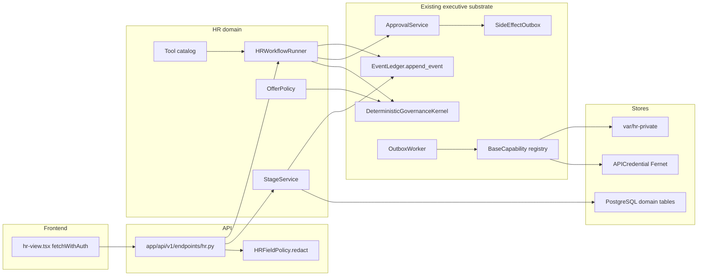
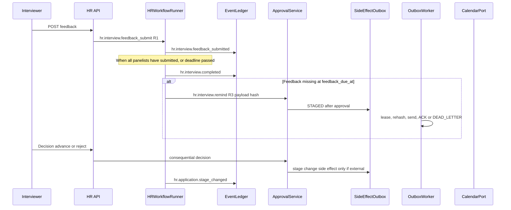
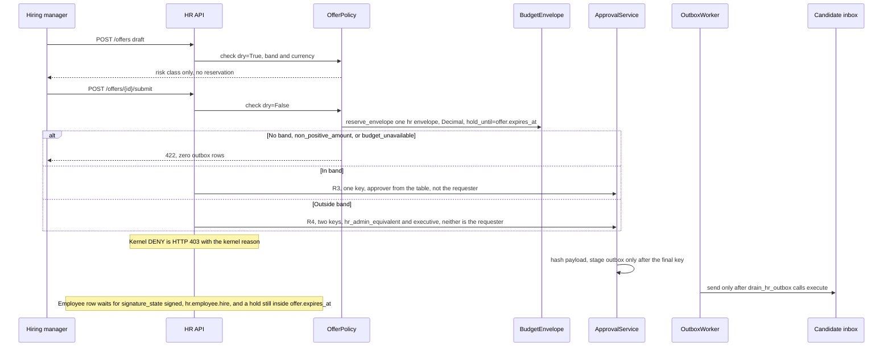

# OctaOS Talent Acquisition & People Operations Master Plan

| Field | Value |
| --- | --- |
| Author | OctaOS Engineering (placeholder) |
| Date | 2026-10-17 |
| Status | Draft |
| Repo | `/Users/sayantande/octaos/OctaOsautomation` |
| Alembic script head | `e1a2b3c4d5f6` (revises `c7d8e9f0a1b2`) |
| Audience | Senior engineers who already work in this repo |

This is the implementation plan for turning the current Hiring screen into a tenant-scoped talent acquisition and people-operations lifecycle. Nine features are committed (five P0, four P1). P2 is specified only so the schema and event names do not have to be rewritten later. P2 is not part of the first delivery.

Uncertainty, checked rather than assumed:

- `alembic heads` on this checkout prints a single head, `e1a2b3c4d5f6` (`alembic/versions/e1a2b3c4d5f6_agent_studio_and_flow_engine.py`). Workspace memory still says a previous database upgrade stopped at `c7d8e9f0a1b2`. This document did not run `alembic current` against a live database. PR-01 must print `alembic current` before upgrading.
- Candidate row counts were not queried. The workspace tree contains resume PDFs under `uploads/resumes/45c055fd-1e60-478d-b789-62a2c8d87967/` (directory listing reported 548 PDFs). That is a local disk observation, not a production census.
- No salary-band, job-requisition, application, interview, offer, or employee tables exist. Finance models were read before that claim was made.

---

## Overview

Hiring in OctaOS is a flat applicant table. `Candidate` in `app/models/verticals.py` stores one free-text `role`, one `status` string (default `sourced`), and one `scorecard` JSON document. Resume ingestion, interview email, and offer rendering all read and overwrite that blob. A second role for the same person replaces `role` and `scorecard`. Interview "scheduling" stores a date, a time, and a Meet URL that the UI invented. Offer email and interview email leave the process with no approval, no payload hash, and no outbox.

The proposed system keeps one person in `candidates` and attaches many `applications`, each bound to a `job_requisitions` row. Stage changes, assessments, interview feedback, and offers are rows and ledger events, not keys inside `scorecard`. External email, calendar writes, rejection, compensation exceptions, and employment-state changes go through the executive approval path that already exists: `DeterministicGovernanceKernel`, `ApprovalService` on `executive_approval_requests`, and `SideEffectOutbox`. `OutboxWorker.process_batch` exists and is not scheduled. PR-05 adds the beat task that drains it. A code-owned `HRWorkflowRunner` decides which step runs next. It does not introduce a fourth workflow engine, and it does not put HR business rules in the Agent Studio flow builder or in Activepieces.

Specialist "agents" are typed tool modules with risk classes and autonomy caps. An LLM may classify an utterance or draft language. It does not decide a stage, a salary, or a send. If a metric's inputs are not stored, the analytics API returns `insufficient_data` and a null value. It does not estimate.

---

## Background & Motivation

### What the code does today

`app/models/verticals.py` `Candidate` (`candidates`):

- `tenant_id`, `organization_id`, `name`, `email`, `role` (string), `scorecard` (JSON), `status` (string, default `sourced`; comment lists `sourced`, `screened`, `interviewed`, `offered`, `hired`).
- No unique constraint on `(tenant_id, email)`. No requisition foreign key.

`HRResumeIngestionJob` (`hr_resume_ingestion_jobs`) tracks batch parse progress for a role string.

The HTTP surface is `app/api/v1/endpoints/hr.py`, mounted at `/api/v1/hr` by `app/api/v1/api.py`. Every route uses `require_permission(Resource.HR, ...)`. The resource is binary: a role can or cannot touch all of HR. There is no field policy. Relevant behaviors:

- `POST /resumes/upload-batch` writes files under `{MEDIA_UPLOAD_DIR}/resumes/{tenant_id}/` (`MEDIA_UPLOAD_DIR` defaults to `uploads`) and stores `resume_link` as `/media/resumes/{tenant_id}/{file}`. `app/main.py` mounts the whole uploads directory with `StaticFiles` at `/media` with the comment that this is for social-platform media. Resume bytes are therefore unauthenticated if the URL is known.
- The same handler looks up an existing row by `(tenant_id, email)` and, on hit, assigns `existing.role = role` and replaces `existing.scorecard`. One person's previous role is destroyed.
- `scorecard.salary_expectation` is the salary string from the upload form, copied onto every parsed candidate. It is not the candidate's stated expectation.
- `POST /{id}/send-interview-email` builds a plain-text body, sends it through `HRAgent` SMTP or Gmail if a credential exists, then sets `status = "interviewed"` and writes `calendar_booked: True` even when delivery failed or no calendar API was called.
- `POST /{id}/generate-offer` renders a markdown template from `CONTRACT_TEMPLATES` in `app/services/hr/contract_service.py`. Signature lines are underscores. Nothing is versioned or stored.
- `POST /{id}/send-offer-email` sends that render and updates the candidate. `require_permission` is `HR`/`CREATE` for send and `HR`/`READ` for generate. No approval service is called.
- Excel import and export round-trip the same flat shape (`/candidates/export-excel`, `/candidates/import-excel`).

The UI is `frontend/src/components/views/hr-view.tsx`, routed from `frontend/src/components/shell/workspace-screen.tsx` when `pathname === '/app/hiring'`. The nav item is `Hiring` at `/app/hiring` in `frontend/src/lib/navigation.ts`. The client calls the API with `fetchWithAuth` from `frontend/src/lib/workspace.tsx`. The interview form initializes `meetingLink` to `https://meet.google.com/octa-interview` and, when a candidate is chosen, to `https://meet.google.com/octa-{id slice}`. That is not a calendar event.

The only HR agent is `app/services/agents/hr.py` `HRAgent.execute_task`, with actions `source_candidates`, `candidate_outreach`, and `schedule_interview`. Sourcing loads `APICredential` for the platform and raises if it is missing. Implemented platform fetches are Greenhouse and Lever only; anything else raises. Match output is written into `Candidate.scorecard`. `_create_calendar_event` can call Google Calendar `freebusy` and `events.insert` with Hangouts Meet, but it ignores the requested time and books "tomorrow UTC for one hour" on the primary calendar. The agent also commits inside `BaseAgent.log_activity`.

A second, thinner writer is `HRSectionAdapter` in `app/services/agents/section_registry.py` (`applicant.create`, `applicant.score`). It commits per action and merges scorecard keys. `app/services/agents/seeder.py` grants the seeded "HR AI" agent `applicant.create`, `applicant.score`, and `email.send`.

`app/core/capabilities.py` `HRSourceCandidatesCapability` (`hr.source_candidates`) is registered at `max_autonomy="L3"` and its `execute` method returns a fake `candidates_sourced` count. It does not insert rows. `app/services/agents/executive/strategist.py` still emits that capability id on talent objectives.

`app/services/agents/boardroom.py` (the block commented "HR AI - Update Candidate Status") sets `candidate.status = "offered"` and commits. If `meeting.trigger_type != "candidate_hiring"`, it takes the latest candidate in the tenant. The `trigger_id` lookup does not filter `tenant_id`. That path is an unapproved employment-adjacent write and a tenant-isolation hole.

Parsing is local and mostly deterministic: `extract_resume_text` and `extract_heuristic_entities` in `app/services/hr/resume_parser.py` (PyMuPDF, then pypdf, then python-docx). `calculate_ats_keyword_score` matches a fixed `COMMON_SKILLS` list that includes "Leadership", "Communication", and "Problem Solving". `evaluate_semantic_fit` asks the LLM for `recommendation` values that include `Reject`, then `compute_composite_ranking` sorts humans by `0.45 * ats + 0.55 * semantic`. The model string returned by `LLMGateway.complete` is not stored on the candidate. `complete` does not call `_track_usage` (that helper is unused). It infers `task_type` from prompt words — `"hr"`, `"candidate"`, `"interview"`, `"recruiter"`, and `"hiring"` map to `"hr"` — injects knowledge-base chunks into the system prompt, and calls `ai_gateway.executeCached`, which writes `ProviderUsage` and commits inside `AIProviderGateway._record_usage_safe`. On failure that helper `rollback()`s the whole session. `ProviderUsage` has no `resource_id` and no `correlation_id`.

Tests that describe the current contract: `tests/test_hr_endpoints.py`, `tests/test_hr_pipeline.py`, plus HR sections of `tests/test_api.py`.

### Platform pieces that already exist and must be reused

Tenancy. `tenant_id` is on the models. `app/core/tenant_scope.py` `scoped_query` filters `tenant_id` and, when an org context is set, `(organization_id == oid) OR organization_id IS NULL`. There is no `Organization` model; `organization_id` is an unscoped string. The file mentions Postgres RLS "when enabled". No migration in `alembic/versions/` enables RLS. Isolation today is application filters. `tests/test_tenant_isolation.py` is the pattern to copy.

RBAC. `app/core/rbac.py` roles are `super_admin`, `admin`, `manager`, `agent`, `read_only`, plus aliases (`member` and `employee` map to `agent`). `Resource.HR` exists. `frontend/src/components/views/members-view.tsx` already describes a finer Hiring matrix than the code enforces.

Two approval models, read and not merged:

| | Executive | Enterprise HITL | Flow engine |
| --- | --- | --- | --- |
| Class | `ExecutiveApprovalRequest`, aliased as `ApprovalRequest` in `app/models/executive.py` | `ApprovalRequest` in `app/models/enterprise.py` | `FlowApprovalRequest` in `app/models/flow_engine.py` |
| Table | `executive_approval_requests` | `approval_requests` | `flow_approval_requests` |
| Writer | `app/core/approval_service.py` `ApprovalService` | `app/services/policy_engine.py` `PolicyEngine` | Flow run steps |
| Binding | SHA-256 of canonical payload, anti-self-approval on R3/R4, `required_keys` 2 when risk is `R4_FINANCIAL_CRITICAL` | JSON payload, confidence, 48h expiry, no hash | JSON payload, single approver, no hash |
| Side effect | Same transaction inserts `SideEffectOutbox` and appends a ledger event. No commit inside `ApprovalService` | `PolicyEngine.evaluate` commits | None |
| Fit for HR | Offers, rejection, calendar send, provisioning | Sales and marketing drafts | Agent Studio reviews |

Hash-chained ledger. `app/core/event_ledger.py` `EventLedger.append_event` writes `WorkflowEvent` (`workflow_events`) inside the caller transaction. It flushes and does not commit. It takes a Postgres transaction advisory lock on `workflow_id`. `workflow_id` is a foreign key to `workflows.id` (`ON DELETE RESTRICT`). `event_type` is `String(64)`.

Durable execution that is actually durable. `app/services/executive_os/execution_engine.py` `DurableExecutionEngine` uses that ledger, `ApprovalService`, and `DeterministicGovernanceKernel`, but `_record_and_publish` commits, and `start_workflow` requires a `plan_version_id`. HR must call `EventLedger` and `ApprovalService` directly and commit once at the HR service boundary. It must not call `DurableExecutionEngine.start_workflow`.

`app/services/durable_workflows.py` `DurableWorkflowService` is a different, weaker facility. It stores `WorkflowCheckpoint` (`workflow_checkpoints`) and commits inside `start_run` and `checkpoint`. The idempotency lookup is not tenant-scoped. `DeadLetterService.replay` re-sends the original Celery task by name with no new governance check. That is not the HR substrate.

Outbox class, not a running process. `app/workers/outbox_worker.py` `OutboxWorker.process_batch` knows how to lease `side_effect_outbox` rows (`FOR UPDATE SKIP LOCKED` on Postgres, batch default 20, lease 60 seconds), re-check `KillSwitch`, re-hash the payload, move the row to `DISPATCHED_UNKNOWN`, call `capability.execute`, then mark `ACKNOWLEDGED` plus a ledger event or `FAILED` / `DEAD_LETTER` after `max_retries` (column default 3). Nothing in `app/main.py`, `app/worker/tasks.py`, or `celery_app.conf.beat_schedule` calls it. The only caller today is `tests/test_executive_os_vertical_slice.py`. `register_capability` fills an in-memory dict at import of `app/core/capabilities.py`. `get_capability_instance` raises `KeyError` for a class that was never imported, and `evaluate` then returns `DENY`. PR-05 adds the beat task that imports `app.services.hr.capabilities` and calls `process_batch`. Until that task is deployed, approved rows stay `STAGED`.

Governance. `app/core/governance.py` `DeterministicGovernanceKernel.evaluate` fails closed. R3 and R4 baseline to `REQUIRE_APPROVAL`. `_is_autonomy_sufficient` returns false for R3/R4 at every autonomy including L3, and allows L2/L3 to pass only R0–R2. It does **not** compare the caller's autonomy to `CapabilityDefinition.max_autonomy`. Cost `>= 1000` escalates to R4 with no currency check (`_escalate_risk`). Budget reservation today is `reserve_budget` against `budget_envelopes`, with the check constraint `reserved_amount + consumed_amount <= authorized_limit`. HR does not call `reserve_budget`. Decision 6 adds `reserve_envelope`.

Policy and audit beside the kernel. `PolicyEngine` and `TenantPolicy.always_approve` are the sales/marketing HITL switch. `AuditService.log_event` writes `audit_logs` and commits; on failure it rollbacks the session. HR code that is inside an open transaction must not call `log_event`. `ComplianceService` export/delete covers `Lead` and `User` only. `DataRetentionPolicy` has `leads_days`, `tickets_days`, `audit_days` (default 2555), `messages_days`. No candidate column.

Knowledge. `KnowledgeRAGService` (`app/services/kb_rag.py`) chunks into `knowledge_chunks` and falls through to `HybridRAGEngine` (`app/services/rag/hybrid_engine.py`): keyword fingerprint plus pgvector cosine on 1536-d embeddings (`app/services/rag/embedder.py`). `KnowledgeAccessController` redacts SSN, card, and phone, and gates `KnowledgeDocument.classification` and `approved_for_external_use`. Department `"HR"` is already a knowledge-document value used by the UI. P2 helpdesk extends this stack. It does not add a second retriever.

Encryption today. `app/core/security.py` Fernet via `ENCRYPTION_KEY` or `SHA-256(SECRET_KEY)`, wrapped in `MultiFernet`. If `SECRET_KEY` is not the dev string, the dev key `dev-only-insecure-secret-key-change-me` is still installed as a decrypt fallback. `encrypt_api_key` / `decrypt_api_key` protect `api_credentials.encrypted_key` only. Resume files and `scorecard` JSON are plaintext. `decrypt_api_key` also returns strings that already look like `sk-`, `AIza`, and similar prefixes without decrypting them.

Three workflow substrates, and why two of them are the wrong place for HR, are decided in [Key Decisions](#key-decisions).

### Pain this causes

- An assessment for role A is overwritten when the same email is ingested for role B. Historical judgment is gone.
- `status` is a mutable string. There is no stage history, so time-to-hire cannot be computed without inventing timestamps.
- Any principal with `HR`/`READ` can read salary text, phone, address, and resume excerpts from the scorecard. The members screen claims otherwise.
- Offer and interview mail are consequential external side effects with no human gate, no idempotency key, and no dead-letter state.
- The boardroom can mark the newest candidate `offered`.
- A public static mount serves resumes.
- Analytics that do not exist yet would be tempted to reuse `roi_service.py`'s "$25/hr" assumption. This plan forbids that for HR metrics.

---

## Goals & Non-Goals

### Committed scope: the nine features

P0 foundation:

1. Structured job requisitions, and a split between a person (`Candidate`) and an application. One person, many applications. An assessment for one role must not be readable as the assessment for another role.
2. Kanban pipeline and stage history. A stage change is an event. `current_stage` is a projection, not the source of truth.
3. Interview kit, structured scorecard, and real scheduling coordination: availability, time zones, panel, reminders, feedback deadlines. Calendar integration is in scope to the extent scheduling cannot work without it. An integrations marketplace is not.
4. RBAC, tenant isolation, audit history, and approval policies for recruiters, hiring managers, HR admins, and executives. Restricted fields: salary, identity documents, interview notes.
5. Offer approvals and contract lifecycle. Offers are checked against an approved salary band, an HR budget envelope, and an authorization limit before any dispatch. Templates are versioned. Signature state, access control, and expiry are stored. No external email and no employment-state change without an approval gate.

P1 automation and operations:

6. Event-driven workflows with idempotency, retries, dead-letter, and history. Reference flow: `interview.completed` → feedback reminder → feedback collected → authorized decision → next stage.
7. Onboarding, offboarding, and employee records, including the directory edges those workflows need. Onboarding tasks do not complete until verification is stored. Offboarding revokes access through an approved workflow and retains required records. This is not payroll and not a full HRIS.
8. HR copilot and specialist tools. Conversational execution of authorized workflows, not a Q&A bot. Tool permissions, approval gates, execution logs, and confirmation before external communications or other consequential changes. Autonomy L0–L3 as defined below. An agent cannot grant itself permissions. Deterministic code for ordinary operations. LLMs only for language understanding or generation.
9. Recruitment analytics and execution observability computed only from persisted events and actual costs. Missing inputs return `insufficient_data`. No forecast is invented. Observability covers workflow runs, agent invocations, tool calls, approvals, errors, retries, external communications, and outcomes.

### P2, designed now, built after the nine

- Talent-pool rediscovery and skills. A skill term list and evidence rows are created in a committed migration so later work does not rebuild applications. Internal match runs on job-related evidence only. No sensitive personal characteristics. Succession and career paths stay a comment and a reserved event name.
- HR knowledge base and employee helpdesk, on `KnowledgeRAGService` / `HybridRAGEngine` / `KnowledgeAccessController`. Cases eventually have owner, priority, SLA, resolution, escalation. No helpdesk UI in the nine.
- Performance, learning, and workforce planning. Objectives, reviews, training completion, demand versus approved headcount. The committed migrations reserve event-type names and leave `Employee.id` and `JobRequisition.id` as the future foreign-key targets. No performance UI in the nine.

### Non-goals (not in any PR in this plan)

- A visual workflow builder, including driving HR through `FlowDefinition.definition` JSON.
- A graph database. Relational skill rows are enough. A graph store is not a prerequisite and is not recommended in the committed scope.
- Payroll, tax withholding, benefits administration, or a full HRIS.
- Automatic rejection, or any write of `rejected` / `hired` that is caused only by a model score.
- Personality, honesty, protected-characteristic, or "culture" inference from resume text.
- A second RAG stack, a second approval table for the same HR action, or a fourth workflow engine.
- Replacing Greenhouse/Lever sourcing with a new scraper. Existing credential-gated fetch stays behind the new application writer.

### Product filter for every screen in the nine

A new screen must reduce hiring time, improve decision quality, automate admin work, or show management a workforce figure computed from stored rows. If it does none of those, it is not in the PR.

---

## Key Decisions

### 1. Candidate versus application, and how today's rows move

**Decision.** Keep the `candidates` table and its primary keys. Add `job_requisitions` and `applications`. A person has one candidate row per tenant. A candidacy for a role is an application. All new assessments, interviews, offers, and stage events foreign-key to `application_id`. They do not foreign-key to "the person's current role".

`role`, `status`, and `scorecard` stay on `candidates` through the first release, readable, not written by new code. They are dropped only in a later migration after a backfill check passes in production. Deleting them in the first migration is how this project would lose data.

**Migration (PR-01), one transaction per tenant batch, idempotent on `application_legacy_sources.legacy_candidate_id`:**

1. Do not delete or rewrite the source `candidates` row's id, name, email, or scorecard.
2. Group real emails. "Real" means non-null, not blank, and not `N/A` (the upload path writes that literal). Within `(tenant_id, lower(email))`, the oldest `created_at` row remains the person. Later rows get `merged_into_candidate_id` set to that person and are hidden by the API. Their bytes stay. Empty and `N/A` emails are not merged; each remains its own person, because collapsing them would fuse unrelated files.
3. If merged rows disagree on name, keep the oldest name on the person and store the other name as an `evidence_facts` row with `source = "legacy_scorecard"` and `fact_type = "alias"`. Do not pick a name with a model.
4. Create one `job_requisitions` row per distinct `(tenant_id, organization_id, normalized role string)`. Null role becomes title `Unspecified role` and `legacy_role_missing = true`. `headcount_approved` starts at 1. It is not inferred from how many candidates share the title. `opened_at` is the earliest candidate `created_at` in the group. That timestamp is explicitly `legacy_opened_at_is_first_candidate`, and analytics must treat it as insufficient for time-to-fill until a human confirms `opened_at` (see decision 5).
5. The form salary copied into every scorecard (`salary_expectation` from `upload-batch`) is copied once onto the requisition as `legacy_salary_text`. It is not copied onto the person as their expectation. There is no structured band yet; PR-07 introduces bands. The legacy string does not authorize an offer.
6. Create **one application per unique** `(tenant_id, surviving_candidate_id, requisition_id)`. Do not create one application per source row. `applications.workflow_id` is nullable in this migration; PR-02 fills it. `current_stage` on that application is the furthest mapped stage among the source rows (`sourced < screened < interviewing < offer < hired`). Map `interviewed→interviewing` and `offered→offer`. Any unknown string maps to `sourced` and is preserved on `application_legacy_sources.legacy_status`. `applications.status` is `hired` only when some source row was `hired`; otherwise `active`.
7. Every original candidate row, including the second and later rows that collapsed onto that application, is stored in `application_legacy_sources` (`application_id`, `legacy_candidate_id` unique, `legacy_status`, `source_email`). Copy each source `scorecard` into its own `assessments` version on that same application (`version` 1, then 2, … ordered by `candidates.created_at`). `kind = "resume_screen"`. Skills, phone, links, and years from that scorecard become `evidence_facts` with `source = "legacy_scorecard"`. `semantic_score`, `fit_verdict`, `recommendation`, and `strengths`/`gaps` become `inferences` on that version, labeled `model_output_untrusted = true`. Nothing is skipped. The composite rank is not a current decision. Case-variant emails (`Jane@x.com` and `jane@x.com`) are the fixture: one person, one requisition, one application, two assessment versions, both scorecards still readable.
8. If `scorecard.resume_link` or `filename` is present, insert an `hr_documents` row that points at the existing path. PR-01 does not move or encrypt those bytes. PR-03 copies them out of the public tree after a checksum match.
9. Scorecard keys `meeting_time`, `meeting_link`, `interview_round`, `interviewer_name` become an `interviews` row with `status = "legacy_unconfirmed"`. Links matching `meet.google.com/octa-` are stored as `unconfirmed_legacy_link = true` and are not treated as provider events. No email is sent by the migration.
10. The API list used by the current UI keeps returning a candidate-shaped payload for one release, built from the latest application, so `hr-view.tsx` does not go blank before the Kanban PR. New writes go to applications. The compatibility projection is removed in PR-02 once the Kanban reads applications.

Duplicate `(tenant_id, candidate_id, requisition_id)` is rejected by a unique constraint. That is why step 6 collapses source rows onto one application instead of inserting two. A later re-apply reuses that row. Withdrawing and re-opening is a stage event on the same application. Upload today matches email with exact `filter_by`, and `POST /api/v1/hr/` plus Excel import do not enforce uniqueness, so case-variant duplicates are expected in real tables.

### 2. Workflow substrate

**Decision.** HR business workflows run on the executive durable substrate, extended with HR domain tables and a code-owned runner. They do not run on the flow engine, on Activepieces automations, or on `DurableWorkflowService`.

Use these existing types as-is:

- Anchor row: `app/models/workflows.py` `Workflow` (`workflows`) with `vertical = "hr"` and `department = "hr"`. One anchor per application (`name = "hr.application:{application_id}"`) and one per employee lifecycle (`name = "hr.employee:{employee_id}"`). The grain is per business object so `EventLedger`'s advisory lock does not serialize every HR write in the tenant. The anchor is not the business record and not a user-editable graph. `Workflow.status` defaults to `"active"`, which is not a `WorkflowState` value. HR inserts set `status` explicitly to `WorkflowState.COMPILED` and move it with `validate_workflow_transition`. Completion rate counts only `RUNNING` then `COMPLETED` or `CANCELLED`. An anchor left at `"active"` is not in the denominator.
- Task rows: `WorkflowTask` for runner steps that wait or dispatch (`task_type` `hr.interview.remind`, `hr.offer.send`, never `email_sequence`). HR code sets `status` to `TaskState` values (`PENDING`, not the column default `"pending"`). Transitions go through `validate_task_transition`. `poll_and_execute_workflows` in `app/worker/tasks.py` already runs every minute and hands `status == "pending"` rows to `app/services/agents/workflow_engine.py` `WorkflowEngine.execute_task`, which marks unknown types `completed` and sends `email_sequence` with no approval. PR-02 excludes `Workflow.vertical == "hr"` and `task_type LIKE 'hr.%'` from that poller before any HR task exists.
- History: `EventLedger.append_event`. Caller commits. HR never calls `DurableExecutionEngine._record_and_publish`.
- Policy: `DeterministicGovernanceKernel.evaluate` plus HR-specific `OfferPolicy` (decision 6), because the kernel's `$1000` escalation is the wrong instrument for salary.
- Human gate: `app/core/approval_service.py` `ApprovalService`, which persists `ExecutiveApprovalRequest` and `ApprovalDecision`. New HR code imports `ExecutiveApprovalRequest` by that name when it must query the table, so it cannot bind the enterprise class by accident.
- Dispatch: `SideEffectOutbox` drained by `OutboxWorker.process_batch` once PR-05 schedules it. The class is not running today. Idempotency key on the outbox is `String(128)` and unique. The value HR stores is also what `record_decision` and the worker pass as `workflow_events.correlation_id`, which is `String(64)`, so the key itself is at most 64 characters (decision idempotency section).
- Money ceiling: a `BudgetEnvelope` with `department = "hr"`, one active row per currency, created by `hr_admin`. HR does **not** call `reserve_budget`. That function has no currency argument, updates every matching row, and `fetchone` records only one. The only production insert (`ceo_interactive_orchestrator.py`) uses `department="EXECUTIVE"` and is not the hiring ceiling. See decision 6.
- Stop switches: `OutboxWorker._is_kill_switch_engaged` checks `KillSwitch` ids `GLOBAL`, the capability id, and `tenant:{tenant_id}` at dispatch time. That check runs only when the drainer runs.
- Recipient blocks: `SuppressionList` is consulted only when the capability input contains `recipient_email` or `email` (`_is_suppressed`). Every external HR payload sets `recipient_email`. `to` alone does not count.
- Declarative extras: `PolicyRule` rows when a tenant wants a stricter rule than the code default. The code default already requires approval for the consequential set. A policy can only make that stricter (`DENY` wins). It cannot weaken it, because the kernel takes the minimum precedence and R3/R4 already baseline to `REQUIRE_APPROVAL`.

Add these types (extension, not a new engine):

- `app/services/hr/workflow_runner.py` `HRWorkflowRunner`. Loads the application and chooses the next code-defined step. External and consequential capabilities call `DeterministicGovernanceKernel.evaluate`, then `ApprovalService.create_request`. Human R1 stage moves do not call `evaluate` (stage machine below). The runner appends the ledger event in the same transaction as the domain write.
- `app/services/hr/capabilities.py`. `BaseCapability` subclasses whose module import calls `register_capability`. The drainer imports that module before `get_capability_instance`. A class that is not imported is a kernel `DENY`, not a silent skip.
- Domain tables in `app/models/hr.py`, listed under Data Model. They are the system of record for hiring state. The ledger is the system of record for what happened.

**Explicitly not used for HR business workflows:**

- Flow engine (`FlowDefinition`, `FlowVersion`, `FlowRun`, `StepRun`, `FlowApprovalRequest`, `ExecutionEvent`). `definition` is a tenant-edited DAG. `FlowApprovalRequest` has no payload hash, no dual key, and no outbox. `StepRun.idempotency_key` is indexed and not unique. `ExecutionEvent` is not hash-chained. The product non-goal forbids a visual builder. `section = "hr"` on a flow remains available for optional marketplace packages and is not the system of record. HR state must not be updated only inside a flow step.
- Automation workflows (`AutomationWorkflow`, `AutomationExecution`, Activepieces `compiled_schema`, `AutomationConnection`). A send that happens in another process cannot commit atomically with the application row and the ledger. Credentials would also leave `APICredential`'s Fernet path.
- `DurableWorkflowService` / `WorkflowCheckpoint` / `DeadLetterJob`. Internal `commit()`, checkpoint overwrite rather than append-only history, and Celery replay that skips the kernel. HR dead-letter is `SideEffectOutbox.status = "DEAD_LETTER"`, which the worker already writes and which does not auto-replay.
- Enterprise `PolicyEngine.evaluate` / `approval_requests` for rejection, offers, calendar sends, hiring, and provisioning. That evaluator commits, stores an unbound JSON payload, and is built for `allow_auto` when confidence is high. HR must not be one confident classification away from an offer email. `TenantPolicy.agent_kill_switches` may still name `hr` as a kill input the runner checks in addition to `KillSwitch`; it is not the approval record.
- `DurableExecutionEngine.start_workflow` and `execute_tick`. Both require a `plan_version_id` and the tick loads `PlanNode` rows. HR does not call them. `get_workflow_projection` already tolerates a missing `plan_version_id` in the payload. Executive plans must not emit `hr.source_candidates` without a `requisition_id`. PR-05 deletes that talent node and its `crm.tag_contact` successor instead of letting `execute` raise inside `execute_tick`.

`event_type` values HR will append (all under 64 characters):

- `hr.application.stage_changed`
- `hr.application.rejection_requested`
- `hr.application.rejection_approved`
- `hr.interview.scheduled`
- `hr.interview.completed`
- `hr.interview.feedback_submitted`
- `hr.offer.approval_requested`
- `hr.offer.sent`
- `hr.offer.accepted`
- `hr.employee.hired`
- `hr.employee.offboarding_started`
- `hr.provisioning.requested`
- `hr.provisioning.verified`
- `hr.agent.tool_invoked`

Reserved for P2, not emitted by the nine: `hr.helpdesk.case_opened`, `hr.performance.review_recorded`, `hr.learning.completed`, `hr.workforce.demand_recorded`, `hr.talent.internal_match`.

### 3. Where assessments, evidence, and inferences live

**Decision.** An assessment belongs to exactly one application and one requisition. It is versioned and never updated in place. Evidence and inferences are child rows. A read API for application B does not join assessments from application A, even when `candidate_id` matches. Cross-application skill reuse is a P2 feature that reads `evidence_facts` where `source = "recruiter_confirmed"` and the human has marked `reusable = true`. Default `reusable` is false. Resume-extracted skills are not silently reused.

Three layers, stored separately so a UI cannot present them as one "score":

| Layer | Table | Who may write it | May it change a stage |
| --- | --- | --- | --- |
| Extracted fact | `evidence_facts.source = "resume_extract"` | Deterministic parser | No |
| Confirmed fact | `evidence_facts.source = "recruiter_confirmed"` | Recruiter or hiring manager | No, by itself |
| Inference | `inferences` | Model or heuristic, always with `model_id` or `heuristic_id`, `prompt_version`, and `supporting_fact_ids` | No |

`assessments.kind` is `resume_screen`, `interview_round`, or `offer_readiness`. `version` increments per `(application_id, kind, interview_id nullable)`. Unique on that tuple. Submitting a new version sets the previous row to `superseded`. The previous row stays. The current recommendation is the latest non-superseded assessment plus its inferences. Historical versions remain queryable and are labeled with their timestamp.

`evaluate_semantic_fit` today asks the model for `Reject`. PR-04 changes the prompt schema to `strengths`, `gaps`, and `narrative` only. If a legacy or model payload still contains `Reject` or `Strong Hire`, the API stores it on the inference as untrusted text and will not return it as an action. The Kanban default sort is time in stage, not composite score. Skill overlap (`matched_skills` / `missing_skills` from `calculate_ats_keyword_score`) is an optional column. Semantic score is not a sort key.

`COMMON_SKILLS` entries `Leadership`, `Communication`, `Problem Solving`, `Agile`, `Scrum`, and `Project Management` are removed from the scoring dictionary. If the tokens appear, they may be stored as `evaluative = false` facts. They do not enter `ats_score`. School name and the address heuristic stay out of the rank inputs. Education level may be stored as a fact and is not a default filter.

No code path may set `applications.status = "rejected"` or `"hired"` because an assessment score crossed a threshold. Rejection and hire are capabilities with human approval (decision 4).

### 4. Autonomy levels, and what L3 must not do

The names line up with `CapabilityRegistry.default_autonomy` / `max_autonomy` (`L0` through `L3` strings already used by the kernel).

| Level | What the tool may do |
| --- | --- |
| L0 Assist | Read and explain. No inserts except an `hr_agent_invocations` log row. |
| L1 Draft | Insert draft requisitions, draft assessments, draft offer rows, and unsent message bodies. No stage change, no outbox row, no employee row. |
| L2 Approved execution | Call `capability.execute` only when an `ExecutiveApprovalRequest` for that payload hash is `APPROVED` and the worker is the caller, or when the kernel returned `ALLOW` for an R0/R1 capability. The agent process never approves its own request. |
| L3 Bounded automation | Only the allow-list below. Every L3 capability is `side_effect_class = R1_INTERNAL_REVERSIBLE`, `is_compensable = true`, and `max_autonomy = L3`. |

L3 allow-list (pre-approved, reversible, internal):

- Recompute the deterministic keyword overlap and write `resume_extract` facts.
- Create an internal reminder *row* (`hr_reminders`) that does not send.
- Mark a feedback-chase task `SKIPPED` or complete when an `interview_feedback` row already exists.
- Refresh `HRResumeIngestionJob` progress counters.

Forbidden at L3, and forbidden at L0–L2 unless a distinct human approval is `APPROVED` and the outbox payload hash matches:

- Reject an application, including a "quiet" stage change with no email.
- Hire, create an `Employee`, or change `employees.status`.
- Any compensation exception, band edit, or offer amount edit after approval (that is a new payload and a new request).
- Send email, create or cancel a calendar event, or post to Greenhouse/Lever.
- Provision or revoke an account.
- Read or export identity documents. The tool catalog does not include an identity-document tool for agents at all.
- Change RBAC, retention, kill switches, autonomy, or `tool_grants`.
- Delete candidates or documents.
- Turn a score into a rejection.

`HRSourceCandidatesCapability.max_autonomy` is lowered from `L3` to `L1` in PR-05. Its `execute` raises `ValueError` when `requisition_id` or `idempotency_key` is missing. It does not return a structured error and it does not invent a count. The same PR stops `strategist.py` from emitting the talent node: today that node passes only `{"role", "count"}`, then a successor `crm.tag_contact` with `contact_id` `batch-{prefix}-candidates`. `TagContactCapability` tags a CRM contact, not a candidate. Both nodes are removed together. A talent objective keeps the finance allocation node and the executive summary says sourcing is a Hiring-screen action that requires a `requisition_id`. It is not auto-planned. Sourcing that only inserts applications is R1. `hr.candidate.email` is R3 and is never granted at L3.

**Kernel gap to close in PR-05.** `DeterministicGovernanceKernel._is_autonomy_sufficient` does not read `max_autonomy`. `HRWorkflowRunner` refuses when the actor's requested level outranks the capability's `max_autonomy`. The same check is added to `evaluate` so executive plan runs cannot bypass the runner. Outranking returns `REQUIRE_APPROVAL`, not `ALLOW`. R3/R4 remain `REQUIRE_APPROVAL` even for L2.

An agent cannot grant itself permissions. Tool grants are read from `AgentVersion.tool_grants` (already the seeder's list). The copilot's actor token is the human's user id. The grant set is the intersection of the human's RBAC and the agent version's grants. There is no tool that writes `tool_grants` or `users.role`.

### 5. How `insufficient_data` analytics work

**Decision.** Every recruitment and execution metric is a tagged value:

```json
{
  "metric": "time_to_fill",
  "status": "ok",
  "value": 18.0,
  "unit": "days",
  "sample_size": 4,
  "missing": [],
  "as_of": "2026-10-17T00:00:00Z"
}
```

When the inputs are not stored, `status` is `insufficient_data`, `value` is JSON `null` (not zero), and `missing` lists stable reason codes. The UI renders the reason. It does not draw a zero bar. Aggregates skip insufficient rows rather than imputing them. If every row is insufficient, the aggregate is insufficient. A partial average is not returned.

Definitions, all from stored timestamps and amounts:

| Metric | Numerator / definition | `insufficient_data` when |
| --- | --- | --- |
| `time_to_hire` | `hired` stage `StageTransition.created_at` minus `applications.applied_at`, per application | Either timestamp null. Legacy imports have `applied_at` null until backfilled from `candidates.created_at` and a human sets `applied_at_confirmed = true`. Unconfirmed legacy is insufficient, not a silent use of `created_at`. |
| `time_to_fill` | For each hire on a requisition, hire timestamp minus `job_requisitions.opened_at` where `opened_at_confirmed = true` | `opened_at` missing or not confirmed. Multi-seat reqs report one sample per hire, not one blended guess. |
| `stage_conversion` | Applications that have a transition into stage B and an earlier transition into stage A, divided by those that entered A. Withdrawn is a separate count, not a pass. | No stage transitions for that pair. |
| `source_quality` | Share of applications with a non-null `source` whose terminal state is `hired` or whose stage reached `offer` | Per source, `sample_size < 5` terminal applications. Sources that are null are counted in an `unknown` bucket and that bucket is always `insufficient_data` until the threshold. Below threshold the API still returns `sample_size`. |
| `cost_per_hire` | Sum of `hr_cost_entries.amount` plus `provider_usage.cost` rows with `task_type` starting `hr.` **and** a non-null `resource_id` equal to the requisition or application, divided by hire count. Those two columns do not exist on `ProviderUsage` until PR-09. | No linked `hr_cost_entries` and no attributed usage row. A usage row with `task_type="hr"` but null `resource_id` does not count (keyword inference in `complete` is not attribution). Absence is not `$0`. `roi_service.py` is not an input. |
| `workload` | Count of `applications.status = active` grouped by `requisitions.recruiter_user_id` | Never imputed. Unassigned is a real bucket, not insufficient. |
| `requisition_aging` | `now - opened_at` for `status = open` and `opened_at_confirmed` | Not confirmed. |
| `plan_vs_actual` | `headcount_filled` versus `headcount_approved`; `hired_at` versus `target_fill_date` if set | `headcount_approved` null. Missing `target_fill_date` omits the date comparison only; headcount can still be `ok`. No forecast of remaining days. |

Execution observability, same envelope:

| Metric | Definition | Insufficient when |
| --- | --- | --- |
| `workflow_completion_rate` | Among HR anchors whose `Workflow.status` is a `WorkflowState` value: count of `COMPLETED` or `CANCELLED` divided by count that reached `RUNNING` (including those still `RUNNING`). Status `"active"` is excluded from both counts. | No HR anchor has ever been set to `RUNNING`. Waiting on approval is neither complete nor failed. |
| `failure_rate` | Outbox rows in `DEAD_LETTER` or `FAILED` with `retry_count >= max_retries`, over rows that left `STAGED` | No dispatched rows. |
| `human_override_rate` | Assessments where a human `assessment_overrides` row contradicts the stored inference label, over assessments that have both an inference and a human decision | No such pair. |
| `cost_per_workflow` | Sum of `provider_usage.cost` where `correlation_id` equals the short HR idempotency key. The column is added in PR-09. Until then, and whenever the column is null, the metric is `insufficient_data`. | No attributed usage row, or `hr_agent_invocations.cost_accounted` is not true. An explicit accounted zero (no model call, flag true, sum 0) is `ok` with value `0`. |
| `time_saved` | `hr_workflow_measures.baseline_manual_minutes` minus `hr_workflow_measures.duration_ms / 60000`. The measure row is 1:1 with the HR `Workflow` anchor. `Workflow` itself has neither column, and this plan does not add them to the shared table. | No measure row, or baseline null. No default minutes-saved constant. |

No metric in this list is a forecast, a fit score, or a fairness score.

### 6. Offer compensation checks without payroll

**Decision.** There is no salary-band source of truth in the repo. `Transaction` is an anomaly row. `FinanceRecord` is invoices, expenses, and AR. `BudgetEnvelope` is a department spend ceiling with a check constraint, not a job band. `Candidate.scorecard.salary_expectation` is a free string. PR-07 adds `salary_bands` as the band source of truth and an audited `hr_admin` route that inserts one active `BudgetEnvelope` with `department="hr"` per currency. That row is the cash ceiling. The only production envelope today is `department="EXECUTIVE"` in `ceo_interactive_orchestrator.py`; offers do not use it. Nothing in this path computes tax, proration, benefits, or a pay run.

`OfferPolicy.check` has two modes. `dry=True` (draft `POST /offers` and `generate-offer`) compares the band and returns the risk class. It does not reserve money. `dry=False` is only `POST /offers/{id}/submit`.

1. Load the active `salary_bands` row for the requisition (`effective_from <= today < effective_to`, same currency). No row: return `band_not_configured` and do not create an outbox item. Do not fall back to `legacy_salary_text`.
2. Compare `offer.base_amount` to band `min_amount` and `max_amount` as `Decimal` against `Numeric(12, 2)` columns. Do not use binary floats for the comparison. Inside the band: send risk is `R3_EXTERNAL_IRREVERSIBLE`, `required_keys = 1`. Outside the band: `R4_FINANCIAL_CRITICAL`, `required_keys = 2`. `record_decision` already rejects the requester for **both** R3 and R4, so the in-band hiring manager who submitted cannot be the single approver. Approver roles are below.
3. On submit only, reserve with new `DeterministicGovernanceKernel.reserve_envelope(envelope_id, workflow_id, task_id, amount: Decimal, idempotency_key, hold_until)`. Do not call `reserve_budget`. `BudgetEnvelope.authorized_limit`, `reserved_amount`, and `consumed_amount`, and `BudgetReservation.amount`, are already `Numeric(12, 2)`. The new method binds `Decimal` and does not coerce with `float()` the way `reserve_budget`, `commit_budget`, and `release_budget` do. It rejects `amount <= 0` with `non_positive_amount` (not `None`); `SELECT ... FOR UPDATE` the single envelope id; updates that row only. `workflow_id` and `task_id` are required: both columns on `BudgetReservation` are non-null. `workflow_id` is the application anchor. `task_id` is that offer's `WorkflowTask.id` (a UUID string, which fits `String(64)`). They are not the idempotency key. `expires_at` on the reservation is `hold_until`, which is `offer.expires_at` (default seven days), not the 60-minute default inside `reserve_budget`. If no active `department="hr"` envelope exists for that currency, or the check constraint would fail, return `budget_unavailable`. Send does not consume the hold. `commit_budget` and `release_budget` stay as they are: they ignore `expires_at` and bind `float(res.amount)`. `reserve_budget` still writes a 60-minute hold for its callers, and those callers still commit through `commit_budget`. HR does not call either function. Decline, rejection, and an `EXPIRED` approval call new `release_hr_hold(idempotency_key)`, which subtracts `Decimal` and sets `RELEASED`. A still-valid hold is consumed only by `consume_hr_hold` at `hr.employee.hire`. The reservation's idempotency key is the 33-character string stored on the `hr.offer.send` approval row (`offers.approval_request_id`). It is not a second `hr:offer-hold:` string, and it is not the later `hr.employee.hire` approval's key. That hire row keeps its own key for its own outbox insert, because `side_effect_outbox.idempotency_key` is unique and the send key is already used.
4. Do not pass `base_amount` through `_compute_cost`. Offer capabilities use `CapabilityCost(type="flat", amount=0)`. `OfferPolicy`, not `_escalate_risk`, chooses R3 versus R4. `financial_impact` is the `Decimal` amount for the approver to read. Job-board invoices are `hr_cost_entries`, not this reservation.
5. The approved payload contains template version id, variable map, currency, `base_amount` as a string of the `Decimal`, band id, `recipient_email`, and the rendered document hash. `record_decision` rejects a mismatched hash. A changed amount is a new offer version and a new request. The drainer re-hashes before send.
6. `generate-offer` and `POST /offers` stay drafts. They do not reserve and do not stage an outbox row. `send-offer-email` is deleted. Submit creates the approval request; the outbox row appears only inside `record_decision` after the final required key.
7. Creating `employees` requires `signature_state = signed` and a separate approved `hr.employee.hire`. The hire approval has its own 33-character key for its own outbox row. `consume_hr_hold` and the expiry `release_hr_hold` are called with the offer-send approval's stored key, the row `offers.approval_request_id` points at. They are not called with the hire row's key. `hr_idempotency_key` includes `capability_id`, so those two keys differ, and `BudgetReservation.idempotency_key` is unique. Neither call uses `commit_budget`. If `now` is past `offer.expires_at` (the reservation's `expires_at`), `consume_hr_hold` is not called, `release_hr_hold` runs with the offer-send key, and the employee row is not inserted. One rule: an expired hold does not create an employee, and it does not leave `reserved_amount` raised. A hold that is still inside `offer.expires_at` stays reserved through send and is consumed at hire, still under the offer-send key.

`hr_admin`, `admin`, and `super_admin` publish bands (effective-dated insert, audited, R1). The same roles, via `POST /api/v1/hr/budget-envelopes`, create at most one active `BudgetEnvelope` with `department="hr"` per currency. The route refuses a second active row for that pair and refuses `department="EXECUTIVE"`. Signup in `app/api/v1/endpoints/auth.py` creates the tenant owner as `role="admin"`, so that owner can create the envelope. Whether finance must co-sign the band itself is an open question. Out-of-band offers are already dual-keyed.

Approver role, enforced on `POST /api/v1/hr/approvals/{id}/decide` before `record_decision`. `PolicyRule.required_roles` is not read by `evaluate` or `record_decision`, so this route is the enforcement. The requester is never an approver for R3 or R4. `admin` and `super_admin` are treated as `hr_admin` in this table: they may decide, and a request they submitted needs a different person. Anti-self-approval still applies. A tenant whose only user is the signup `admin` cannot approve that user's own offer; the row stays `PENDING` until a second user in the approver cell decides. That is the existing R3 rule, not a missing row.

`hr_admin_equivalent` means `hr_admin`, `admin`, or `super_admin`.

| Capability | Risk | Requester role | Who may approve |
| --- | --- | --- | --- |
| `hr.application.reject`, `hr.interview.schedule`, `hr.interview.cancel`, `hr.interview.remind`, `hr.candidate.email`, in-band `hr.offer.send` | R3, 1 key | `hr_recruiter`, `hr_hiring_manager`, `manager`, `agent` | One `hr_admin_equivalent` user. Not the requester. |
| Same R3 capabilities | R3, 1 key | `hr_admin`, `admin`, `super_admin` | One different user who is `hr_admin_equivalent` or `executive`. Not the requester. |
| Same R3 capabilities | R3, 1 key | `executive` | One `hr_admin_equivalent` user. Not the requester. |
| Out-of-band `hr.offer.send`, `hr.employee.hire`, `hr.provisioning.grant`, `hr.provisioning.revoke` | R4, 2 keys | Any role in this table, including `admin` and `super_admin` | Two different users, neither is the requester. One is `hr_admin_equivalent`. One is `executive`. |

Every requester role that can submit is a row in this table. A role that is not listed cannot submit and cannot decide.

A hiring manager sees the amount because they authored the draft, not because the approval is assigned to them. The field matrix says that. `executive` and `hr_admin_equivalent` see the amount on requests their role may decide.

### 7. Documents, retention, and who can read restricted fields

**Decision.** New HR bytes do not go through `app.mount("/media", StaticFiles(...))`.

Today's writer (`upload_resumes_batch`) and today's mount (`app/main.py`) are the problem. The mount cannot be removed in an HR PR: the comment and `app/services/media/storage.py` say `/media` is how social posts are fetched by Meta and LinkedIn. HR stops sharing that tree.

- `LocalPrivateDocumentStore` writes `{HR_PRIVATE_DIR}/{tenant_id}/{object_id}`. Default `HR_PRIVATE_DIR` is `var/hr-private`, which is not under `MEDIA_UPLOAD_DIR` and is not mounted. A `DocumentStore` protocol is the port: `put`, `stat`, `open`. An object-storage adapter is not in the nine. The port is three methods so a later S3 adapter does not change callers.
- PR-03 copies existing resume files to the private dir, checks SHA-256, repoints `hr_documents.storage_key`, then deletes the public copy. Failure leaves the public file and records `copy_status = failed` for a human. The authenticated read route is `GET /api/v1/hr/documents/{id}` with tenant filter and field policy. `resume_link` public URLs stop being returned.
- Classification on `hr_documents.classification`: `recruiting` (resume, portfolio), `interview_notes`, `compensation` (offer renders that contain a number), `identity`.
- Encryption. Identity and compensation objects are Fernet-encrypted with `HR_DATA_ENCRYPTION_KEY` before they hit disk. That key is required when such an upload happens. There is no dev-key fallback in this helper, unlike `_fernet()` in `app/core/security.py`. If the key is absent, the upload fails closed. Recruiting resumes are access-controlled in PR-03 and encrypted with the same helper in PR-11, so the foundation PR is not blocked on key distribution for the 548 existing PDFs, and identity documents never land in plaintext. API credentials stay on `encrypt_api_key`. The dev-key fallback in `_fernet()` is called out as a risk; this plan does not use it for HR documents. Removing the fallback globally is outside the HR nine because it can break decryption of existing credentials; it is noted for security, not done here.
- Keys live in the process environment (`HR_DATA_ENCRYPTION_KEY`), not in the database and not in `api_credentials`.

Field policy is enforced in `app/services/hr/field_policy.py` `HRFieldPolicy.redact` on every HR response, including approval payloads and excel export. Hiding a column only in React is not the control. Excel export today dumps the scorecard; PR-03 redacts before write.

| Field class | Recruiter `hr_recruiter` | Hiring manager `hr_hiring_manager` | HR admin `hr_admin` | Executive `executive` | Existing `admin` |
| --- | --- | --- | --- | --- | --- |
| Pipeline (name, stage, requisition title, source) | read/write | read/write on owned requisitions | read/write | read | read/write |
| Recruiting PII (email, phone, resume) | read/write | read on owned reqs | read/write | no | read/write |
| Interview notes (free text, per-interviewer) | no, unless they are on the panel | panel member or owner of the req | read | no | read |
| Rubric scores (numeric criteria, no free text) | read | read/write on owned | read/write | read aggregate | read/write |
| Salary, bands, offer amounts | no | sees the draft they authored; not an approver | read/write; approves offers they did not submit | read and approve when the table names them; not the band editor | read/write; same decide rights as `hr_admin`; cannot approve their own request |
| Identity documents | no | no | read/write | no | read/write |

`normalize_role` does **not** map `manager` to `hr_hiring_manager` or `agent` to `hr_recruiter`. Those existing roles keep their current non-HR grants (finance, settings, leads). `HRFieldPolicy` special-cases the role string: `manager` gets hiring-manager field behavior on HR responses, and `agent` (which already includes normalized `member` and `employee`) gets recruiter field behavior, including no salary. `read_only` stays pipeline-only. `super_admin` remains `*` in `ROLE_PERMISSIONS`. `HRFieldPolicy` gives `super_admin` the same HR field visibility as `admin`. Signup (`app/api/v1/endpoints/auth.py`) creates `role="admin"`. Both are `hr_admin_equivalent` in the approver table, and neither may approve their own R3 or R4 request. Ownership is `job_requisitions.hiring_manager_user_id` or `recruiter_user_id`, or a row in `requisition_panel`.

`has_permission` returns false for a role missing from `ROLE_PERMISSIONS`. PR-03 adds the four roles with these grants, and no other resources:

```python
"hr_recruiter": {"hr": ["create", "read", "update"]},
"hr_hiring_manager": {"hr": ["create", "read", "update"]},
"hr_admin": {
    "hr": ["create", "read", "update", "delete", "execute"],
    "audit_logs": ["read"],
},
"executive": {
    "hr": ["read", "execute"],
    "audit_logs": ["read"],
    "ceo": ["read", "execute"],
    "finance": ["read"],
},
```

`execute` on `executive` is the decide route, not pipeline mutation. Route gates on top of that, because `generate-offer` is `HR`/`READ` today and a bare read grant would still open salary:

| Route | `hr_recruiter` | `hr_hiring_manager` | `hr_admin` | `executive` | `agent` | `manager` | `admin` | `super_admin` |
| --- | --- | --- | --- | --- | --- | --- | --- | --- |
| GET list, applications, ingestion | yes | yes | yes | yes | yes | yes | yes | yes |
| POST person, application, upload, import, internal transition | yes | yes | yes | no | yes | yes | yes | yes |
| DELETE candidate | no | no | yes | no | no | no | yes | yes |
| POST assessments, proposed interviews, feedback | yes | yes | yes | no | yes | yes | yes | yes |
| POST reject submit | yes | yes | yes | no | no | yes | yes | yes |
| Draft or generate offer, submit offer | no | yes | yes | no | no | yes | yes | yes |
| Decide approval | no | no | yes, if the table names them and they are not the requester | yes, if the table names them and they are not the requester | no | no | yes, same cell as `hr_admin`, not the requester | yes, same cell as `hr_admin`, not the requester |
| GET document | field policy | field policy | yes | no identity, no notes | recruiting only | owned req | yes | yes |
| POST budget envelope or band | no | no | yes | no | no | no | yes | yes |
| GET analytics | no | owned req | yes | yes | no | owned req | yes | yes |
| POST copilot | L0–L1 | L0–L1 and submit | yes | read tools only | L0–L1 | L0–L1 and submit | yes | yes |

`admin` keeps the current `hr: create, read, update, delete, execute` and compensation visibility. `super_admin` keeps `*`. The decide route still applies the approver table after `require_permission`, so `*` does not waive anti-self-approval. Field policy still runs after the route gate.

Retention uses `DataRetentionPolicy`, extended with nullable columns rather than a parallel table: `candidates_days`, `applications_days`, `recruiting_docs_days`, `identity_docs_days`. Null means "do not auto-purge this class". `auto_purge_enabled` already defaults false, and it stays false until a tenant opts in. `ComplianceService.request_export` and `request_delete` gain a candidate branch: export lists applications, stage timestamps, and document hashes; delete anonymizes name and email, deletes private document bytes, and keeps ledger rows (hashes of payloads, not a fresh copy of the resume). Ledger payloads for HR must therefore store document ids and amounts, not raw resume text. That is also why prompt bodies are not written into `workflow_events`.

`GDPRRequest` is the access-request queue. The same table serves export and delete. A new `request_type` of `access` is unnecessary if export is the access fulfillment; the plan uses `export` and `delete` as they exist. Identity-document purge on rejection is a retention job, not an immediate silent delete, so a legal hold can set `hr_documents.legal_hold = true` and the job skips it. `SuppressionList.reason = LEGAL_HOLD` remains the outreach block; the document flag is the storage block.

Candidate-facing mail stays multipart with a plain-text part (the current `MIMEText` body is the text part). Scheduling UI shows the zone abbreviation next to the local time, not a color alone. Kanban columns are buttons with text labels, not color-only dots. No timed candidate test is introduced.

Consent. `applications.consent_status` is `unknown_legacy`, `applicant_submitted`, or `basis_recorded`, plus `consent_text_version` and `lawful_basis`. The migration sets `unknown_legacy`. New external capabilities (`hr.candidate.email`, calendar attendee invites to the candidate) refuse that status. Internal stage moves do not. Whether legacy sourced people may be emailed under legitimate interest is an open question; the code default is to refuse until a basis is recorded.

### 8. Specialist agents are typed tools, not extra personas

**Decision.** Do not add fourteen system prompts. Add one orchestrator and a catalog of tool handlers.

`app/services/hr/agents/orchestrator.py` `HROrchestrator.handle(utterance, actor)` does:

1. Resolve the human (`actor.user_id`, role, tenant).
2. Optionally call new `LLMGateway.complete_isolated` (PR-09) with a tool menu (names and one-line descriptions, not the handlers) to obtain `{tool, arguments, prompt_version}`. That entry does not inject knowledge-base chunks and does not commit. `complete` stays unchanged for marketing callers. The prompt template's hash is the `prompt_version`. The filled prompt is not stored. If the gateway is unavailable, return a clarification; do not guess a send.
3. Look up `ToolSpec` in the in-process catalog. Unknown tool: deny.
4. Intersect `AgentVersion.tool_grants` for slug `hr_ai` with the human's RBAC and with the tool's `required_permissions`.
5. Validate arguments with the tool's pydantic model. Coercion failures are a 422, not a model retry loop inside the request.
6. Call `HRWorkflowRunner.invoke(tool, args, autonomy=min(requested, tool.max_autonomy))`.
7. Write `hr_agent_invocations` in the same transaction: tool name, autonomy, `model_id`, `prompt_version`, evidence ids, approval id, the short correlation id, status. `complete_isolated` returns `(text, provider, model)` and asks `AIProviderGateway` to `add` + `flush` a `ProviderUsage` row with `task_type="hr.{tool}"`, `resource_id`, and `correlation_id` (columns added in PR-09). It does not call `_record_usage_safe` and it does not call the unused `_track_usage`. Until those columns exist, cost metrics stay `insufficient_data`.
8. External or consequential tools return the draft and the approval id to the UI. The UI confirms. Confirmation is `ApprovalService.record_decision` by the human, not a second model call.

`LearningLoop.record_decision` commits and is the marketing learning loop. HR does not use it as the governance log. `ActivityLog` may be written after commit for the existing teams feed. It is not the audit.

Catalog (module → tools). Handlers live under `app/services/hr/agents/`. The seeded HR AI row in `seeder.py` loses `email.send`. Grants become the tool names below that are L0–L2. L3 tools are not on the conversational grant list; a cron calls them by capability id.

| Catalog name | Module | Committed tools | Deferred |
| --- | --- | --- | --- |
| HR Orchestrator | `orchestrator.py` | route only | |
| Requisition | `requisition_tools.py` | `hr.requisition.draft`, `hr.requisition.submit` | |
| Sourcing | `sourcing_tools.py` | wraps Greenhouse/Lever fetch; requires credential or raises, as `HRAgent._source_candidates` does today; writes applications | |
| Resume Intelligence | `resume_tools.py` | `extract_resume_text` + facts; optional narrative inference | |
| Skills Matching | `matching_tools.py` | `calculate_ats_keyword_score` only | semantic rediscovery |
| Interview Kit | `kit_tools.py` | draft kit from requisition requirements | |
| Interview Coordination | `schedule_tools.py` | propose slots, submit schedule for approval | |
| Candidate Communications | `comms_tools.py` | draft body; send only via outbox | |
| Offer | `offer_tools.py` | draft, `OfferPolicy.check`, submit | |
| Onboarding | `onboarding_tools.py` | create tasks, record verification | |
| Employee Helpdesk | none in the nine | tool id reserved, handler returns `not_implemented` | P2, via `KnowledgeRAGService.answer_context` with `department="HR"` and `refuse_if_empty=True` |
| HR Analytics | `analytics_tools.py` | read `RecruitmentAnalytics`, pass through `insufficient_data` | |
| Compliance | `compliance_tools.py` | call `ComplianceService` export/delete, which an admin must confirm | |
| Verification | `verification_tools.py` | compare onboarding evidence hashes; deterministic | |

`HRAgent` remains as a facade so `app/services/agents/orchestrator.py` `daily_routine` and the boardroom import do not break. `execute_task` delegates to the tool catalog. The boardroom block that sets `status = "offered"` is deleted in PR-05. PR-09 keeps the facade from calling a send without the runner. `HRSectionAdapter.applicant.score` stops merging a global scorecard; it writes an assessment on an explicit `application_id` or returns an error.

Prompt storage decision, justified: store the template id and SHA-256 prefix (`resume_narrative_v1:` + 12 hex chars), the `model` string, evidence ids, and overrides. Do not store the filled prompt. The filled prompt contains resume text, which would be copied into `workflow_events.canonical_payload` and `hr_agent_invocations` and then retained for the audit horizon. The template lives in git, so the hash is enough to reproduce the instructions. Overrides are `assessment_overrides` (`actor_id`, `before`, `after`, `reason`, `created_at`). Approval decisions stay in `approval_decisions`.

---

## Proposed Design

### Shape



The UI never calls a provider. `OutboxWorker.process_batch` is the only process that performs an external side effect, and it does not run until PR-05 deploys the beat task `drain_hr_outbox`. Until that task is deployed, approved rows stay `STAGED`. The API process only inserts domain rows, ledger events, and `STAGED` outbox rows. It does not send mail.

### Stage machine

Code in `StageService`, not a JSON DAG. Legal transitions:

- `sourced → screened → interviewing → offer → hired`
- `rejected` or `withdrawn` from any non-terminal stage
- `hired` and `rejected` have no outbound edge except a correction by `hr_admin`, `admin`, or `super_admin` that writes a new transition and a ledger event of type `hr.application.stage_changed` with `correction = true`. Corrections do not send email.

`sourced → screened` and `screened → interviewing` (the internal move, before any invite is sent) do not call `DeterministicGovernanceKernel.evaluate`. `evaluate` defaults `actor_autonomy` to `L1`, and `_is_autonomy_sufficient` is false for every risk class at L0 and L1, so an R1 call at recruiter autonomy becomes `REQUIRE_APPROVAL`. Passing L2 instead would also let an agent skip the gate. One path: `StageService.transition` checks the caller role (`hr_recruiter`, `hr_hiring_manager`, `hr_admin`, `admin`, `super_admin`, and the existing strings `manager` and `agent`) and the legal edge, then inserts one `stage_transitions` row and one ledger event. It inserts zero `executive_approval_requests` rows. Rejection is not this method. An agent at L3 cannot call it. The copilot tool for these two edges has `max_autonomy` L2 and its handler is still `StageService.transition`, so it also creates no approval request. PR-02 tests that a recruiter stage change inserts one transition and zero approval rows. Sending the invite is a different capability and does call `evaluate`.

Rejection always creates an approval request for `hr.application.reject`. The stage does not move until that request is approved. On approval, the same transaction appends the stage event and updates `current_stage`. It does not call the outbox insert inside `record_decision`. That method, once `required_keys` are met, always `db.add`s a `SideEffectOutbox` for `req.capability_id`. PR-05 adds an exception: `capability_id == "hr.application.reject"` writes the stage event and inserts no outbox row. There is no `execute` for that capability. A no-op `execute` would be `ACKNOWLEDGED` and never retried. An `execute` that writes the stage again has no legal edge out of `rejected` except a correction. `hr.candidate.email` is registered in PR-09, where `execute` actually sends, and that outbox row uses its own 33-character key. Until PR-09, approval of a rejection does not email the candidate. If a later send is dead-lettered, the stage stays `rejected` and the UI shows that outbox row's `last_error`. A recruiter can submit a new send with a new key. They cannot pretend the stage did not change.

### Reference workflow: interview feedback



Reminder bodies are part of the approved payload. Editing the body after approval changes the hash and is rejected by `record_decision`. The default `feedback_due_at` is interview `end_at` plus 24 hours, overridable on the kit. The reminder job is a scheduled call into `HRWorkflowRunner`, not an Activepieces trigger and not `task_type="email_sequence"`. The repo already runs Celery (`app/worker/tasks.py`, `app/core/celery_app.py`). PR-08's deadline beat calls the runner and does not send mail itself. Mail leaves only through `drain_hr_outbox` from PR-05. `poll_and_execute_workflows` must not see these tasks; PR-02 excludes them before any HR `WorkflowTask` exists (decision 2).

### Offer path



Draft and `generate-offer` do not reserve. Submit is the only reservation. The diagram matches decision 6 and the API table.

### Scheduling port

`CalendarPort` in `app/services/hr/calendar_port.py`:

- `free_busy(tenant_id, user_ids, window, tz) -> list[BusyInterval]`
- `create_event(tenant_id, payload, idempotency_key) -> ProviderEvent` including the provider's meeting URL
- `cancel_event(tenant_id, external_event_id, idempotency_key) -> None`

`GoogleCalendarAdapter` is the first implementation. It replaces the behavior in `HRAgent._create_calendar_event`: that method uses `googleapiclient` `freebusy` and `events.insert` with `hangoutsMeet`, but it discards `suggested_time` and uses `datetime.utcnow() + 1 day`. The adapter takes an explicit start, end, and `timeZone`, checks free/busy for each panel member's calendar id (not only `primary` of the credential owner), and refuses to invent a Meet URL if the provider does not return `hangoutLink`. Credentials stay in `APICredential` provider `gmail` or a dedicated `google_calendar` provider, decrypted with `decrypt_api_key` at execute time inside the worker, not logged. A Microsoft adapter implements the same protocol later. It is not a second scheduling model.

Panel assignment is `interview_panelists (interview_id, user_id, response)`. Reminders are outbox capabilities, not `setTimeout` in the API.

### Copilot request path

The copilot is a panel on the existing Hiring view, not a new product shell. `POST /api/v1/hr/copilot` accepts `{utterance, application_id?, requisition_id?, confirm_token?}`. Without `confirm_token`, L1 tools may draft and L2/R3 tools return `approval_required` plus the draft. With `confirm_token`, the server checks it equals the pending approval id and that the caller is an authorized approver, then calls `record_decision` with `request.idempotency_key`. It does not compute a new key. The model is not in that second call.

### Idempotency

`ApprovalService.record_decision` and `OutboxWorker` both pass the outbox `idempotency_key` straight through as `workflow_events.correlation_id`. That column is `String(64)`. `side_effect_outbox.idempotency_key` and `budget_reservations.idempotency_key` are `String(128)`. A composed key `hr:{tenant_id}:{capability_id}:{subject_id}:{payload_sha256_16}` is about 107 characters. Postgres rejects the ledger insert. SQLite does not enforce `VARCHAR(64)`, so a length assert in the SQLite suite is not the test.

One short value is stored on `budget_reservations.idempotency_key`, on new `executive_approval_requests.idempotency_key`, and on `side_effect_outbox.idempotency_key`. Do not widen `correlation_id`, and do not store a long key on the outbox that the worker would later copy into the ledger. Do not compute a second key at decide time.

`hr_idempotency_key(tenant_id, capability_id, subject_id, payload_canonical) = "h" + sha256(f"{tenant_id}|{capability_id}|{subject_id}|{payload_canonical}").hexdigest()[:32]`

That is 33 characters: under 64, with headroom under 128. `payload_canonical` is `json.dumps(payload, sort_keys=True, separators=(",", ":"))`, the same bytes `create_request` hashes into `payload_hash`. The approval model has no payload column. PR-05 adds `idempotency_key` `String(64)`, nullable, with `CHECK (capability_id NOT LIKE 'hr.%' OR idempotency_key IS NOT NULL)`. Existing non-HR callers omit it. An `hr.` request without it fails the check. The preimage fields sit in the canonical dict (`tenant_id` and `capability_id` are also columns; `subject_id` is inside the dict). They are not a second key. The offer hold uses this same string, not `hr:offer-hold:{offer_id}:{version}`.

`create_request` today does not take `idempotency_key`. Its required arguments are `workflow_id`, `plan_version_id`, `task_id`, `capability_id`, `capability_version`, `payload`, `risk_class`, `title`, and `description`. `task_id` is `String(64)` and non-null on `ExecutiveApprovalRequest` and on `SideEffectOutbox`. PR-05 adds `idempotency_key` to that signature and writes it on the row. HR passes `task_id` as the `WorkflowTask.id` created in the same transaction. That id is a UUID and is not the 33-character key.

`record_decision` today copies the `idempotency_key` argument the caller passes into the outbox row and into `correlation_id`. After PR-05, if the row's column is set, `record_decision` uses that stored value and raises if the argument differs. The decide route reads the column and passes it. It does not call `hr_idempotency_key` again. `expire_hr_approvals` and `release_hr_hold` / `consume_hr_hold` use that same stored value. The worker already copies the outbox key into `correlation_id` on ACK.

`StageTransition.idempotency_key` uses the same function and a unique constraint. A retried client POST returns the original transition. External providers are called with that same key. Google `conferenceData.createRequest.requestId` is the 33-character key, not a fresh `uuid4` the way `_create_calendar_event` does today (a retry would create a second event).

PR-05 adds `tests/test_hr_idempotency_postgres.py`, skipped unless `TEST_DATABASE_URL` is Postgres. It inserts through `create_request` (the new column equals the 33-character key), through `EventLedger.append_event` with that same `correlation_id`, and through the worker ACK path (`correlation_id=item.idempotency_key`). A decide call that passes a different string does not stage an outbox row. It does not assert `len(key) <= 64` on SQLite and stop there.

### Transaction boundary

`StageService.transition` and `HRWorkflowRunner.invoke` do the following without an intermediate commit:

1. `SELECT ... FOR UPDATE` the application row, filtered by `tenant_id`.
2. Mutate the domain row.
3. `db.add` the `StageTransition` or other child.
4. `EventLedger.append_event` (flush only).
5. If a side effect is authorized, `db.add` the `SideEffectOutbox` row **or** call `ApprovalService.create_request` (flush only). The worker, not this transaction, sends.
6. `AuditService.stage_event` (new method: `add` + `flush`, no `commit`, no `rollback` of the caller's transaction).
7. One `commit`.

`AuditService.log_event`, `BaseAgent.log_activity`, and `LearningLoop.record_decision` commit today. `AIProviderGateway._record_usage_safe` commits and, on failure, `rollback()`s the whole session. `LLMGateway._track_usage` is unused; HR does not call it and PR-09 does not add a `commit=False` flag to it. New HR paths do not call any of those helpers before step 7. Copilot usage goes through `LLMGateway.complete_isolated` (PR-09): no knowledge-base injection, `add` + `flush` of `ProviderUsage` with `task_type`, `resource_id`, and `correlation_id`, and no commit. The HR caller commits once at step 7. `complete` stays as it is for marketing callers.

### Scale assumptions

This is an in-app ATS for a tenant, not a multi-million-row job board. The design target per tenant is about 50 open requisitions, 2,000 applications a year, and about 10 stage events per application. At that size, p95 for an internal stage change (no provider) should stay under 300 ms on the same Postgres the API already uses. Calendar `freebusy` is outside that budget. The Google client call sets `timeout=5`. A new helper `retry_transport` in `app/services/hr/calendar_port.py` retries once, and only on transport errors and HTTP 5xx, then stores the error. It does not invent an available slot. Do not use `app/core/http_utils.py` `with_retry`: that decorator is tenacity `stop_after_attempt(3)` with waits of 2, 4, and 8 seconds and it retries every `Exception`. It sets no timeout. Outbox settings stay at the worker's current defaults (batch 20, lease 60 seconds, `max_retries` 3) unless a HR capability sets a lower `max_retries` on its own row. Advisory locks are per application workflow id, so 2,000 applications do not queue behind one lock.

Indexes are created in the migration. A filter does not create one. `Candidate.tenant_id` has no `index=True` today. PR-01 adds `ix_candidates_tenant_id` on `candidates.tenant_id`, `ix_applications_tenant_candidate` on `(tenant_id, candidate_id)`, and `ix_applications_tenant_req_stage` on `(tenant_id, requisition_id, current_stage)`. PR-02 adds `ix_stage_transitions_application_created` on `(application_id, created_at)`. Unique keys are the ones named in the data model. Do not add a vector index for resumes in the nine. Keyword skill match is the deterministic scorer. Hybrid search stays on the knowledge base.

### What changes in existing HR entry points

- `upload-batch` creates or reuses a person, creates an application on a requisition id (the form gains `requisition_id`; a missing id is a 422, not a silent role string), and writes facts. It does not set a hire recommendation.
- `send-interview-email` and `send-offer-email` become "submit payload for approval". The old direct SMTP block is deleted, not left behind a flag that defaults on.
- `HRSectionAdapter` requires `application_id`.
- Boardroom HR status writes are removed.
- Compatibility GET `/api/v1/hr/` remains one release, then the Kanban uses `/api/v1/hr/applications`.

---

## API / Interface Changes

All routes stay under `/api/v1/hr` and keep `Depends(get_current_tenant_id)` plus `require_permission`. Field policy runs after the permission check. Mutations accept `Idempotency-Key`. A replay with the same key and the same body returns the original response. The same key with a different body is 409.

| Method and path | Change |
| --- | --- |
| `GET/POST /api/v1/hr/` | Read compatibility projection. POST creates a person only, not an application. Deprecated after PR-02. |
| `POST /api/v1/hr/requisitions` | Create draft requisition. |
| `POST /api/v1/hr/requisitions/{id}/submit` | Moves draft to `pending_approval`. Opening a req is R1 for `hr_admin` once this plan's approval policy says headcount was approved offline, or R3 if the tenant's `PolicyRule` says so. Default is `hr_admin` may open because no external side effect occurs. |
| `POST /api/v1/hr/applications` | `{candidate_id, requisition_id, source}`. |
| `POST /api/v1/hr/applications/{id}/transition` | Internal legal transition. Rejection returns `approval_required` and does not move the stage. |
| `GET /api/v1/hr/applications?requisition_id=&stage=` | Kanban source. Redacted. |
| `POST /api/v1/hr/applications/{id}/assessments` | New version. Body separates `confirmed_facts` from client-supplied text. The server runs the parser; it does not trust a client-supplied `match_score`. |
| `POST /api/v1/hr/interviews` | Creates `proposed`. Does not email. |
| `POST /api/v1/hr/interviews/{id}/schedule` | Submits the calendar payload for approval. |
| `POST /api/v1/hr/interviews/{id}/feedback` | One row per interviewer. Constraint `uq_interview_feedback_author` on `(interview_id, author_user_id)`. Panelists stay `uq_interview_panelist` on `(interview_id, user_id)`. |
| `POST /api/v1/hr/offers` | Draft. Runs `OfferPolicy.check(dry=True)`. Does not reserve. |
| `POST /api/v1/hr/budget-envelopes` | `hr_admin`, `admin`, and `super_admin`. One active `department="hr"` envelope per currency. Refuses `EXECUTIVE`. |
| `POST /api/v1/hr/offers/{id}/submit` | `OfferPolicy.check(dry=False)` calls `reserve_envelope` with `workflow_id`, `task_id`, and the 33-character key, then `create_request` stores that same key. Replaces direct `send-offer-email`. |
| `POST /api/v1/hr/approvals/{id}/decide` | Approver table in decision 6, including `admin` and `super_admin`. Passes `request.idempotency_key` to `record_decision`. Does not build a second key. Requester is rejected for R3 and R4. |
| `POST /api/v1/hr/offers/{id}/accept` | Manual signature token. Sets `signature_state`. Does not create an employee. |
| `POST /api/v1/hr/employees` | Only from an accepted offer, and only as an approval submit. |
| `POST /api/v1/hr/employees/{id}/offboard` | Approval submit for revocation. |
| `GET /api/v1/hr/analytics?metric=` | Tagged value, including `insufficient_data`. |
| `POST /api/v1/hr/copilot` | Orchestrator. |
| `GET /api/v1/hr/documents/{id}` | Authenticated stream. Replaces public `/media/resumes/...` for HR. |
| `GET /api/v1/hr/workflows/{application_id}` | Projection from `workflow_events` plus outbox status. This is the execution history screen. |

`generate-offer` remains as a draft renderer but persists the template version and document hash. `contract-templates` reads `offer_template_versions` (seeded from today's `CONTRACT_TEMPLATES` dict) instead of only the in-memory dict.

Example gate the offer route must hit before any socket opens:

```python
canonical_payload = {
    "offer_id": str(offer.id),
    "recipient_email": candidate.email,  # _is_suppressed reads this, not "to"
    "template_version_id": str(offer.template_version_id),
    "currency": offer.currency,
    "base_amount": str(offer.base_amount),  # Decimal rendered as a string
    "band_id": str(offer.band_id),
    "document_sha256": offer.document_sha256,
}
decision = kernel.evaluate(
    capability_id="hr.offer.send",
    capability_version="1.0.0",
    inputs=canonical_payload,
    actor_role=user.role,
    actor_autonomy="L1",  # human submit; R3 stays REQUIRE_APPROVAL at every autonomy
)
if decision["decision"] == "DENY":
    raise HTTPException(status_code=403, detail=decision["reason"])
if decision["decision"] == "ALLOW":
    # R3 send must not ALLOW. Bug guard, not the suppression path.
    raise HTTPException(status_code=409, detail="offer_send_must_be_approved")
if decision["decision"] != "REQUIRE_APPROVAL":
    raise HTTPException(status_code=403, detail=decision.get("reason") or decision["decision"])
# WorkflowTask.id is String, a UUID, and fits task_id String(64). It is not the idempotency key.
task = WorkflowTask(
    id=str(uuid4()),
    workflow_id=application.workflow_id,
    task_type="hr.offer.send",
    status=TaskState.PENDING.value,
)
idem = hr_idempotency_key(tenant_id, "hr.offer.send", str(offer.id), canonical_payload)
check = OfferPolicy(db, tenant_id).check(
    offer,
    dry=False,
    envelope_id=envelope.id,
    workflow_id=application.workflow_id,
    task_id=task.id,
    idempotency_key=idem,
    hold_until=offer.expires_at,
)
if check.status != "ok":
    raise HTTPException(status_code=422, detail=check.status)
ApprovalService(db, tenant_id).create_request(
    workflow_id=application.workflow_id,
    plan_version_id=None,  # legal only because capability_id LIKE 'hr.%'
    task_id=task.id,
    capability_id="hr.offer.send",
    capability_version="1.0.0",
    payload=canonical_payload,
    risk_class=check.risk_class,
    title=f"Send offer {offer.id}",
    description="Candidate offer send",
    financial_impact=offer.base_amount,  # Decimal onto Numeric(12, 2); do not float()
    requester_user_id=str(user.id),
    idempotency_key=idem,  # stored on the approval row; decide reads it back
)
```

Every external HR capability (`hr.offer.send`, `hr.interview.schedule`, `hr.interview.cancel`, `hr.interview.remind`, `hr.candidate.email`) puts the address in `recipient_email`. `to` alone does not trip `_is_suppressed`. PR-05 tests that a `SuppressionList` row for that address returns kernel `DENY` and inserts zero `side_effect_outbox` rows.

`ApprovalService.create_request` currently requires `workflow_id`, `plan_version_id`, `task_id`, `capability_id`, `capability_version`, `payload`, `risk_class`, `title`, and `description`. It does not take `idempotency_key`. The approval row stores `payload_hash` and has no payload column and no idempotency-key column. `plan_version_id` is non-null with `ForeignKey("plan_versions.id", ondelete="RESTRICT")`. HR does not have a strategy `PlanVersion`. PR-05 makes `plan_version_id` nullable and adds `CHECK (plan_version_id IS NOT NULL OR capability_id LIKE 'hr.%')` in the same migration. The FK stays. The same migration adds nullable `idempotency_key` `String(64)` and `CHECK (capability_id NOT LIKE 'hr.%' OR idempotency_key IS NOT NULL)`. `create_request` persists that argument. `record_decision` copies the stored column into the outbox and into `correlation_id`, and it rejects a different argument. The decide route rebuilds `canonical_payload` from the offer version so the hash check still runs, and it passes the stored key. It does not call `hr_idempotency_key`. `DurableExecutionEngine.start_workflow` and `execute_tick` still require a plan and are not called for HR. `get_workflow_projection` already tolerates a missing plan in the payload. CEO routes in `app/api/v1/endpoints/ceo_v5.py` require `plan_version_id`; HR approvals are not passed there. PR-05 greps `plan_version_id` and null-guards every reader that assumes the id is present. This is not a second approval table.

Analytics response when legacy requisitions were never confirmed:

```json
{
  "metric": "time_to_fill",
  "status": "insufficient_data",
  "value": null,
  "unit": "days",
  "sample_size": 0,
  "missing": ["opened_at_confirmed"],
  "as_of": "2026-10-17T00:00:00Z"
}
```

---

## Data Model Changes

New module `app/models/hr.py`, imported from `app/models/verticals.py` the same way `sales_intelligence` is imported at the bottom of that file, so `Base.metadata` sees the tables. String UUID primary keys, `tenant_id` FK to `tenants.id`, nullable `organization_id` string to match the rest of the schema. No new Organization entity.

| Table | Role | Constraints that matter |
| --- | --- | --- |
| `job_requisitions` | Opening | `(tenant_id, id)` lookups. `status` in `draft, pending_approval, open, on_hold, closed, filled`. `opened_at_confirmed` bool default false. |
| `applications` | Candidacy | Unique `(tenant_id, candidate_id, requisition_id)`. No `legacy_candidate_id` column. `workflow_id` is a nullable FK to `workflows.id` in PR-01. PR-02 inserts the anchor and then sets the column `NOT NULL`. |
| `application_legacy_sources` | Every pre-migration `candidates` row | Unique `legacy_candidate_id`. FK `application_id`. Created and filled in PR-01. |
| `stage_transitions` | History | Unique `idempotency_key`. FK `ledger_event_id` → `workflow_events.id`. |
| `assessments` | Versioned judgment | Unique `(application_id, kind, version)`. FK requisition and application. No FK-only-on-candidate. |
| `evidence_facts` | Facts | `source` in `resume_extract, recruiter_confirmed, legacy_scorecard, model_inference`. `model_inference` is allowed only as a pointer at an inference, not as a confirmed skill. `extracted_at` not null. |
| `inferences` | Model or heuristic claims | `supporting_fact_ids` JSON. `prompt_version` not null when `model_id` is set. |
| `assessment_overrides` | Human contradiction of an inference | |
| `interview_kits` | Rubric for a requisition | Unique `(requisition_id, version)`. |
| `interviews` | A scheduled or proposed round | `tz` not null. `meeting_url` nullable. |
| `interview_panelists` | Users on a round | Constraint name `uq_interview_panelist` on `(interview_id, user_id)`. |
| `interview_feedback` | One submission | Constraint name `uq_interview_feedback_author` on `(interview_id, author_user_id)`. The writer column is `author_user_id`, not `user_id`. FK `assessment_id`. |
| `salary_bands` | Comp range | `min_amount <= mid_amount <= max_amount` check. Effective dating. No update-in-place of amounts. |
| `offer_template_versions` | Versioned markdown | Seeded from `CONTRACT_TEMPLATES`. |
| `offers` | A versioned offer | Unique `(application_id, version)`. `payload_hash`. FK `approval_request_id` nullable until submit. `signature_state` in `none, awaiting, signed, void`. `status` in `draft, pending_approval, approved, sent, accepted, declined, expired, rescinded`. |
| `employees` | Person we hired | FK `application_id`, `candidate_id`, nullable `user_id`, nullable `manager_employee_id`. No compensation column. Comp stays on the offer, behind field policy. |
| `onboarding_tasks` | Checklist | `verified_at` null means not complete, even if `status` was posted as done. The service rejects complete without verification when `verification_required` is true. |
| `provisioning_requests` | Grant or revoke | `action` in `grant, revoke`. Unique `idempotency_key`. FK approval. `system` in `google, microsoft, manual`. |
| `hr_documents` | Metadata for bytes | `classification`, `sha256`, `storage_key`, `legal_hold`. |
| `hr_cost_entries` | Actual spend a human entered | `amount`, `currency`, `requisition_id`, `source` (`job_board`, `agency`, `other`). |
| `hr_agent_invocations` | Tool log | `prompt_version`, `model_id`, `autonomy`, `approval_request_id`, `cost_accounted` (bool, default false). Created in PR-09. |
| `hr_workflow_measures` | Duration for one HR anchor | 1:1 with the HR `Workflow`. `baseline_manual_minutes` and `duration_ms`, both nullable. Created in PR-09. Not columns on `workflows`. |
| `hr_reminders` | Internal reminder rows | No recipient email column. Sending is a capability. |
| `skill_terms` | P2 hook | Unique `(tenant_id, normalized_name)`. Self-FK `parent_id` nullable. No UI in the nine. |
| `skill_evidence` | P2 hook | FK `skill_terms.id`, FK `evidence_facts.id`. Proficiency nullable. |

`candidates` gains nullable `merged_into_candidate_id`, `phone`, and `consent` is **not** stored on the person; it is stored on the application because basis can differ by role. A partial unique index on `(tenant_id, lower(email))` where email is a real email is added only after the merge step, in the same migration, so it cannot fail on the pre-merge duplicates. SQLite tests: the partial index is created only when the dialect is PostgreSQL; the service still enforces the merge. That matches how other migrations in this repo branch on the dialect.

`DataRetentionPolicy` gains the nullable day columns listed in decision 7. `ExecutiveApprovalRequest.plan_version_id` becomes nullable with `CHECK (plan_version_id IS NOT NULL OR capability_id LIKE 'hr.%')` and keeps its FK. The same PR-05 migration adds `executive_approval_requests.idempotency_key` `String(64)` nullable, with `CHECK (capability_id NOT LIKE 'hr.%' OR idempotency_key IS NOT NULL)`. There is still no payload column on that table. `provider_usage` gains nullable `resource_id` and `correlation_id` in PR-09. `ProviderUsage.cost` stays `Float`, which is the existing usage column. Salary, bands, envelopes, and reservations stay `Numeric(12, 2)`. `commit_budget` and `release_budget` keep binding `float`; HR consume and release do not call them.

Indexes, created by name in the migration, not implied by a filter:

- PR-01: `ix_candidates_tenant_id` on `candidates.tenant_id` (the column has no `index=True` today); `ix_applications_tenant_candidate` on `(tenant_id, candidate_id)`; `ix_applications_tenant_req_stage` on `(tenant_id, requisition_id, current_stage)`.
- PR-02: `ix_stage_transitions_application_created` on `(application_id, created_at)`.

`workflows` rows are inserted by the application and employee services, not by a seed of a giant HR DAG.

P2 performance tables are not created. Future tables will FK `employees.id` and `job_requisitions.id`. Creating empty `objectives` tables now would imply a product the nine do not ship.

### Migration strategy

- Revision chain: new file `down_revision = "e1a2b3c4d5f6"`. If `alembic current` is still `c7d8e9f0a1b2`, upgrade to head first. Do not fork a second head.
- Expand then contract. PR-01 adds tables and backfill and does not drop `candidates.role`, `status`, or `scorecard`.
- Backfill is in the migration for the structural copy (requisition, application, assessment JSON copy) so a deploy cannot serve the new API against an empty application table. File moves are **not** in the Alembic transaction (filesystem is not transactional). PR-03 runs a management command `python -m app.services.hr.migrate_resumes` that is resumable via `hr_documents.copy_status`.
- Rollback of PR-01 is `downgrade()` dropping the new tables. Old columns were not modified, so the old UI still works. Downgrade refuses if any application has a stage transition newer than the backfill marker, and tells the operator to restore a snapshot instead of silently deleting hiring history.
- Tests run against SQLite as the current HR tests do, and one Postgres test covers the partial unique index and the advisory lock path if `TEST_DATABASE_URL` is set. Do not pretend SQLite exercised `FOR UPDATE SKIP LOCKED`.

---

## Alternatives Considered

### A. Keep extending `Candidate.scorecard` and `HRAgent`

This is the status quo. `HRSectionAdapter.applicant.score` already deep-merges JSON, and `upload-batch` already replaces the blob.

Why it loses: a JSON document cannot enforce "this score is for requisition A". Stage history cannot be reconstructed after the next overwrite. Salary cannot be redacted without a second projection that will drift. `HRAgent._schedule_interview` and `send-offer-email` will still send from the request process. The boardroom will still flip `offered`. Every analytics PR would start with a caveat that the timestamps are guesses. The approach is smaller by a migration and worse on every committed requirement. It is rejected.

### B. Adopt an external ATS and only integrate

Greenhouse and Lever are already optional *sources* inside `_fetch_real_candidates`. Making one of them the system of record would avoid building Kanban and offers.

Why it loses against this codebase: the product is the Hiring module inside OctaOS. Approvals, the ledger, budget envelopes, tenant RBAC, and the copilot are the platform's actual differentiation, and they do not run inside Greenhouse. An external system of record would fork candidate state the way `CRMSyncRecord` forks leads, and the boardroom and `hr.source_candidates` would keep writing the local table anyway. Identity documents and salary would sit in a vendor the field policy does not wrap. Integration stays as a source adapter. It is not the plan of record.

### C. One monolithic HR prompt versus the specialist catalog

A single new "HR OS" prompt that calls tools through the existing `HRAgent.execute_task` string actions would feel like one agent and would match the seeder's "HR AI" persona.

Why it loses: `execute_task` is an untyped branch. The model that already returns `recommendation: Reject` would be one bad parse away from a stage write if the prompt is the policy. `email.send` is already on the HR AI grant list. The executive kernel cannot see a tool the prompt invented in prose. The specialist design keeps one orchestrator prompt for language and puts every mutation in a `BaseCapability` with a risk class the kernel already knows how to deny. The con is more modules and a stricter seeder diff. That con is accepted. The monolithic prompt is rejected.

### D. Drive HR on the flow engine or on Activepieces

Considered under decision 2 and rejected there. Short version: the flow engine's approval row and the automation engine's external runtime do not meet payload-hash approval, transactional outbox, and "no visual builder". Extending them until they did would be a fourth engine wearing an old name. The executive substrate already has the safety properties; HR was simply never wired to it.

---

## Security & Privacy Considerations

### Threat model

| Threat | Severity | Exists today | Mitigation in this plan |
| --- | --- | --- | --- |
| Unauthenticated read of resumes via `/media` | Critical | Yes. `StaticFiles` on `uploads/`, links stored in scorecard | Private dir, authenticated GET, copy-then-delete in PR-03. Do not unmount `/media` globally. |
| Offer or interview email without a human gate | High | Yes. `send-offer-email`, `send-interview-email` | Those handlers stage approvals. After PR-05, `drain_hr_outbox` is the only sender. The approval-gate test lands in PR-05, before PR-06 restores a provider call. |
| Boardroom sets `offered`, sometimes on the latest candidate, sometimes without `tenant_id` | High | Yes. `boardroom.py` HR block | Removed. Regression test with two tenants. |
| Score for role A reused on role B | High | Yes. Email match overwrites `role` and `scorecard` | Application-scoped assessments. Unique person/requisition. |
| Model output `Reject` treated as a decision | High | The prompt allows the label. Status is not auto-set today, but the UI can present it as one | Label stripped from actions. No stage write from inference. |
| Any `HR` reader sees salary in JSON and in Excel | High | Yes | `HRFieldPolicy` on every serializer including export. |
| Dev Fernet key decrypts HR documents | High if we reused `_fernet()` | The fallback is installed for API keys | Separate `HR_DATA_ENCRYPTION_KEY`, no fallback, fail closed. |
| Agent raises its own autonomy or calls `email.send` | High | `email.send` is granted to HR AI | Grant intersection. No grant-editing tool. `max_autonomy` enforced. |
| Cross-tenant read | High | Endpoints filter `tenant_id`. Boardroom trigger path does not. RLS is not enabled | `scoped_query` plus explicit `tenant_id` on writes. Test in PR-01 copied from `tests/test_tenant_isolation.py`. Org filter still ORs `organization_id IS NULL`; do not treat org context as a security boundary. It is not one today. |
| `AuditService.log_event` commits or rollbacks the caller's transaction | Medium | Yes | `stage_event` for HR transactions. |
| Ledger or invocation rows store resume text | Medium | Would be new | Payloads carry ids and hashes. Prompt template hash only. |
| `$1000` kernel rule dual-keys every salary by accident, or fails to, depending on currency | Medium | Kernel behavior is real and currency-blind | Offer path does not pass salary as capability cost. `OfferPolicy` sets R3 vs R4. |
| Calendar retry creates a second Meet | Medium | `requestId` uses a fresh UUID | Idempotency key is the request id. |
| Bias metric treated as a control | High if we shipped one | Not shipped | Not shipped. Open question. |
| Offboarding forgets a grant | High once provisioning exists | N/A | Revoke is an approved capability per `provisioning_requests` row that was granted. Task cannot complete until the provider or a human verification row says revoked. |
| Copilot prompt injection from a resume | Medium | Resume text is already sent to `evaluate_semantic_fit` | Resume text is data in the user message, not instructions. Tool name must be in the catalog. `KnowledgeAccessController.scan_for_prompt_injection` runs on kit text and handbook text. A resume cannot name a tool that is not in the intersection grant. |

Authn stays the current bearer session (`fetchWithAuth` → `fetchWithSession`). Authz is RBAC plus field policy plus ownership. Agents act as the human; the ledger `actor_type` is `AGENT` and `actor_id` is the agent slug, and `payload.user_id` is the human. Both are required.

Candidate privacy. Export and delete go through `GDPRRequest` and the extended `ComplianceService`. Suppression list is checked before any candidate email. Identity documents are admin-only and encrypted. The parser's address guess is stored as an unconfirmed fact and is not required to schedule.

Accessibility. Text labels on stages, visible time zone, plain-text email part, no color-only state, no new timed test.

AI governance. Each inference and each invocation stores model id, prompt template hash, evidence ids, and, when a human disagrees, an override. Approval rows store the decision and the rationale already required by `ApprovalDecision.rationale` (non-null column). Full prompt text is intentionally absent; see decision 8.

Bias monitoring approach and its limits, without pretending it is a control. The committed system does not collect gender, age, ethnicity, disability, or a photo score, and it does not infer them. Pass rates by stage, by source, and by recruiter are computable from `stage_transitions` and are operational metrics, not fairness metrics. A legally authorized program would need a voluntary self-identification store that is excluded from prompts, scorecards, excel exports, and agent tools, and a pre-registered comparison (for example the four-fifths rule on a stage pass rate) with a minimum sample. That comparison is not proof of fairness: small N, proxy variables (school, location, career gaps), intersectionality, and selection into the applicant pool are all outside one ratio. Until counsel for the first jurisdiction says this is in scope, the code does not compute it and does not show a "fairness" badge. The open question records that gate.

---

## Observability

Logging. HR services log `tenant_id`, `application_id`, `capability_id`, `approval_id`, `outbox_id`, and `correlation_id`. They do not log email bodies, document bytes, salary amounts, or decrypted credentials. `OutboxWorker` already logs exceptions with the outbox id. Amounts stay in the approval row, which is access-controlled, not in application logs.

Traces. The API already has Prometheus middleware (`PrometheusMiddleware` in `app/main.py`). Add counters and histograms, not a new backend:

- `hr_stage_transition_seconds` (histogram)
- `hr_approval_pending` (gauge by capability)
- `hr_outbox_status` (counter by status and capability)
- `hr_calendar_errors` (counter)
- `hr_analytics_insufficient_total` (counter by metric)

Alerting, using whatever already scrapes Prometheus (this plan does not add a vendor):

- Outbox `DEAD_LETTER` for `capability_id` prefix `hr.` in the last 15 minutes: page the operator. A dead letter means a candidate may be waiting on a decision that was approved but not delivered.
- Approval still `PENDING` with `expires_at < now`: alert when the row is more than one hour past expiry. Nothing in the repo writes status `EXPIRED` today, and `record_decision` ignores `expires_at`. PR-05 adds both writers: `record_decision` rejects the decision, sets `EXPIRED`, and calls `release_hr_hold` with the approval row's stored idempotency key; beat task `expire_hr_approvals` does the same for rows nobody tries to decide. Neither path calls `release_budget` or builds a new key. The alert is sweeper lag. It does not describe a job that already exists.
- `hr_calendar_errors` rate above 5/hour: ticket, not a page, unless scheduling is the only path and interviews are within 24 hours. Keep this threshold editable. It is a starting point, not a SLO commitment.
- Private document `copy_status = failed` after PR-03: ticket, because a resume may still be on the public mount.

The Hiring UI execution drawer reads `GET /api/v1/hr/workflows/{application_id}` and shows the ledger event types, outbox status, retry count, and last error. It shows `insufficient_data` for cost and time-saved when the flags say so. It does not show a model-invented ETA.

`complete` already sets `task_type="hr"` when the prompt contains those keywords, and that row has no `resource_id` or `correlation_id`. A `task_type` prefix is not attribution. `cost_per_hire` and `cost_per_workflow` count only usage rows with those columns populated, which PR-09 adds. Until that migration, and whenever the columns are null, those two metrics and `time_saved` (which reads `hr_workflow_measures`, not `workflows`) stay `insufficient_data`. Anchor status is a `WorkflowState` value, not the column default `"active"`.

---

## Rollout Plan

No calendar estimate. Phase 1 is the kernel migration, the candidate backfill, the resume copy, the approval gate, and the outbox drainer. That is larger than a bundle of five feature PRs.

| Phase | PRs | Outcome |
| --- | --- | --- |
| 1 | PR-01 through PR-05 | Multi-role pipeline, kits and feedback, permissions, audit, approval gate, and `drain_hr_outbox`. The drain test acknowledges `hr.test.noop` only. No production send, and no `ACKNOWLEDGED` `hr.offer.send`. |
| 2 | PR-06, then PR-07, then PR-08, PR-09, and PR-12 | Calendar, then offer approvals, the feedback workflow, copilot tools, analytics. |
| 3 | PR-10 and PR-11 | Employees, onboarding verification, offboarding, retention, resume encryption. |
| 4 | PR-13 and PR-14 | P2. Not part of the nine. |

Parallelism:

- After PR-01 merges, PR-02 (Kanban and the poller exclusion) and PR-03 (RBAC and private files) can proceed in parallel. They touch different layers (`StageService`, `app/worker/tasks.py` versus `rbac.py`, field policy, file copy).
- PR-04 waits for PR-02. It alters tables PR-01 created. It does not create them again.
- PR-05 waits for PR-02 and PR-03. It is the gate and the drainer. PR-06 and any employee write wait for PR-05. PR-07 waits for PR-06.
- PR-06 and PR-07 both edit `app/services/hr/capabilities.py`, `app/api/v1/endpoints/hr.py`, and `frontend/src/components/views/hr-view.tsx`. They are serialized. PR-07 depends on PR-06.
- PR-08 waits for PR-06 so `interview.completed` is real, and for PR-05 so the runner and the drainer exist.
- PR-09 waits for PR-05's capability registry and is finished after PR-07 so offer tools are real. The orchestrator skeleton can start once PR-05 merges. The strategist talent node is already gone in PR-05.
- PR-12 waits for PR-02, PR-05, and PR-08. Cost and time-saved stay `insufficient_data` until PR-09's columns exist. It can run beside PR-10.
- PR-10 waits for PR-07. PR-11 waits for PR-10.
- PR-13 and PR-14 wait for the nine and are not scheduled into the first delivery.

Feature flags. Use the existing `TenantSubscription.feature_overrides` JSON rather than a new flag service. Keys: `hr_applications` (PR-01), `hr_private_docs` (PR-03), `hr_approvals` (PR-05, default on once migrated; there is no "send the old way" flag), `hr_calendar` (PR-06), `hr_offers` (PR-07), `hr_copilot` (PR-09), `hr_employees` (PR-10). A flag hides the new UI. It does not re-enable unapproved SMTP. The old send functions are deleted in the PR that replaces them.

Rollback. Each PR is independently revertable at git level. Schema rollback is the Alembic downgrade described above, refused when post-backfill history exists. If a dispatched HR capability mis-sends, engage `KillSwitch` id `hr.offer.send` (and the other `hr.*` ids). `OutboxWorker.process_batch` checks that before `execute`, and that method runs in production only after PR-05's `drain_hr_outbox` beat task is deployed. That is the emergency stop. It does not unsend mail. Compensation for email capabilities returns `COMPENSATION_NOT_SUPPORTED` the same way `SendSalesSequenceCapability` does, and the product shows that.

Production hardening is inside the PRs, not a follow-up: tenant-isolation tests in PR-01, approval-gate tests in PR-05 before any later PR sends mail or writes `employees`, migration checksums in PR-03, outbox failure and dead-letter tests in PR-08, retention and cross-tenant document tests in PR-11, analytics fixture tests that expect `insufficient_data` in PR-12.

Deploy order inside a release: migrate, deploy API that still serves the compatibility projection, deploy frontend, run the resume copy command, turn on `hr_private_docs`. Do not deploy the frontend that requests `/documents/{id}` before the API that serves it. For PR-07, roll the worker that imports `hr.offer.send` before or with the API that approves it. A worker that does not yet have that class must fail the row, not acknowledge it.

---

## Risks

| Risk | Severity | Mitigation |
| --- | --- | --- |
| `plan_version_id` non-null blocks HR approvals | High | PR-05 makes the column nullable, keeps the FK, and adds `CHECK (plan_version_id IS NOT NULL OR capability_id LIKE 'hr.%')`. Postgres test: an `hr.` request with a null plan commits; a non-HR request with a null plan fails the check. Readers that assume the id are null-guarded. HR does not call `execute_tick`. |
| Kernel `$1000` rule double-controls or mis-controls offers | Medium | `OfferPolicy` is the comp decision; capability cost is 0. Test both INR and USD amounts above and below 1000. |
| Partial unique index not created on SQLite, tests pass, Postgres migration fails | Medium | Postgres-dialect migration test or a documented `alembic upgrade` check in CI when `TEST_DATABASE_URL` is present. Service-level duplicate check either way. |
| Resume copy deletes the only copy | High | Delete the public file only after SHA-256 match. Failed rows keep the public file and raise an alert. |
| Executive talent plans call `hr.source_candidates` and expect a fake success | Medium | `execute` raises `ValueError` when `requisition_id` or `idempotency_key` is missing. It does not return a structured error. The same PR (PR-05) deletes the talent node and its `crm.tag_contact` successor from `strategist.py`. The finance allocation node stays. Sourcing is not auto-planned. The id is only referenced from `strategist.py` and the capability itself. |
| `scoped_query` org OR NULL leaks org-scoped rows across orgs inside a tenant | Medium | Documented. HR authorization uses requisition ownership, not org id. Do not claim org isolation. |
| Two approval UIs (enterprise queue vs executive queue) hide HR offers from the screen operators already watch | Medium | The Hiring view and the executive approval surface both list `capability_id LIKE 'hr.%'`. HR does not also insert `approval_requests`. |
| Scope creep into payroll or a workflow builder | High | Non-goals are PR review criteria. No PR below adds those packages. |
| Legal retention or bias numbers get invented by engineering | High | Open questions. Defaults for purge stay null / `auto_purge_enabled` false. |

---

## Open Questions

These are product or counsel decisions. The engineering defaults are in force until they are answered. They do not block PR-01.

1. **Calendar provider for the first tenant.** Scheduling today is Google, inside `HRAgent._create_calendar_event` (free/busy and `events.insert`), and Gmail is already an email path. A second Google client, `CalendarApiClient.fetch_google_calendar_events` in `app/services/marketing/context_radar/calendar_api.py`, reads public holidays. It is not a free/busy implementation and it is out of scope for this plan. It does not change the Google-first choice. The plan implements `GoogleCalendarAdapter` first behind `CalendarPort`. If the first paying tenant is Microsoft-only, PR-06 should build `MicrosoftGraphCalendarAdapter` instead and leave Google second. The port does not change. Which adapter is first?
2. **E-sign.** The offer PR ships versioned templates, expiry, and `signature_state`, with a one-time acceptance link (`ManualAcceptancePort`). It does not integrate DocuSign or Adobe. Does the first jurisdiction require a named e-sign vendor inside Phase 2, or is tokenized acceptance acceptable until after the nine?
3. **Who publishes a salary band?** No band table, finance table, or scorecard field is a source of truth today (verified in `Transaction`, `FinanceRecord`, `BudgetEnvelope`). The plan lets `hr_admin` publish an effective-dated band, and requires a second key only for out-of-band offers. Must finance co-approve every band before it can be used, or only the exceptions?
4. **Bias monitoring for the first jurisdiction.** The measurement limits are in Security. The nine do not compute a disparity score. Is a voluntary self-id program in scope for that jurisdiction, or explicitly out?
5. **Legacy sourced candidates and outbound mail.** The code default is to refuse external email and candidate calendar invites while `consent_status = unknown_legacy`. May this tenant keep emailing people who were sourced before the migration, or is the default correct?
6. **Retention durations.** Mechanism is `DataRetentionPolicy` plus opt-in `auto_purge_enabled` (already default false). Counsel still needs to set `candidates_days`, `applications_days`, `recruiting_docs_days`, and `identity_docs_days` for the first jurisdiction. Engineering will not ship a purge with a guessed statutory period.

---

## PR Plan

Twelve pull requests cover the nine features. Two more are deferred P2 and are not part of the first delivery. Each PR includes its tests. None add a workflow builder, a graph database, payroll, or automatic rejection. None introduce a fourth workflow engine.

Order is the merge order. PR-06 merges before PR-07. They are not a parallel pair.

Table ownership. A later PR alters a table; it does not `CREATE` it again.

| Table or column | Created | Later change |
| --- | --- | --- |
| `job_requisitions`, `applications` (`workflow_id` nullable), `application_legacy_sources`, `assessments`, `evidence_facts`, `inferences`, `hr_documents`, `interviews` (legacy, unconfirmed) | PR-01, and the backfill inserts them | PR-04 alters assessments, evidence, inferences, documents, and interviews. It does not create them. |
| `ix_candidates_tenant_id`, `ix_applications_tenant_candidate`, `ix_applications_tenant_req_stage` | PR-01 | |
| `workflows` anchor for each application, `stage_transitions`, `ix_stage_transitions_application_created`; `applications.workflow_id` set then `NOT NULL` | PR-02 | PR-01 does not insert a `Workflow`. |
| `interview_kits`, `interview_panelists`, `interview_feedback`, `assessment_overrides`, `skill_terms`, `skill_evidence` | PR-04 | Empty skill tables are the P2 hook. No UI. |
| `ExecutiveApprovalRequest.plan_version_id` nullable plus the `hr.%` check, and `idempotency_key` `String(64)` plus the `hr.%` presence check | PR-05 | |
| `salary_bands`, `offer_template_versions`, `offers`, `hr_cost_entries`, HR `budget_envelopes` rows | PR-07 | |
| `hr_reminders` | PR-08 | |
| `hr_agent_invocations`, `hr_workflow_measures`, `provider_usage.resource_id`, `provider_usage.correlation_id` | PR-09 | |
| `employees`, `onboarding_tasks`, `provisioning_requests` | PR-10 | |
| Retention day columns on `DataRetentionPolicy` | PR-11 | |

### PR-01 — Split people from applications and add requisitions

- **Phase:** 1. **Feature:** 1 (committed).
- **Depends on:** none. `down_revision = "e1a2b3c4d5f6"` after `alembic current` is confirmed.
- **Files:** new `app/models/hr.py`; import from `app/models/verticals.py`; new `alembic/versions/*_hr_requisitions_and_applications.py`; `app/schemas/verticals.py` (application and requisition schemas; keep `Candidate`); `app/api/v1/endpoints/hr.py` (requisition and application routes, upload writes applications, stop overwriting `role`); `app/services/hr/migration_map.py` (pure functions used by the migration and by tests); `frontend/src/components/views/hr-view.tsx` (requisition picker on upload; list still renders); `tests/test_hr_pipeline.py`, `tests/test_hr_endpoints.py`, new `tests/test_hr_tenant_isolation.py` modeled on `tests/test_tenant_isolation.py`.
- **Changes:** Creates every table the backfill inserts: `job_requisitions`, `applications` (`workflow_id` nullable; no `Workflow` row), `application_legacy_sources`, `assessments`, `evidence_facts`, `inferences`, `hr_documents`, and `interviews` left unconfirmed with no calendar call. Named indexes from the data model, including `ix_candidates_tenant_id`. One application per unique `(tenant_id, surviving_candidate_id, requisition_id)`. Extra source rows, including emails that differ only by case, become the next assessment version and `evidence_facts`, with `legacy_candidate_id` on `application_legacy_sources`. No drop of `scorecard`. Compatibility GET remains. Tenant isolation test creates two tenants and asserts application, assessment, and document metadata from tenant A are absent from tenant B, including the boardroom-style query once it is wrapped.
- **Tests:** Fixture with two same-role rows whose emails differ only by case. After upgrade: one person, one requisition, one application, two assessment versions, both scorecards readable, both legacy ids present. A second fixture with one scorecard still round-trips the JSON.
- **Not in this PR:** stage events, sends, encryption, employee rows, `Workflow` anchors.

### PR-02 — Record stage history and show the Kanban

- **Phase:** 1. **Feature:** 2 (committed).
- **Depends on:** PR-01.
- **Files:** `app/services/hr/stage_service.py`; `app/services/hr/workflow_runner.py` (anchor `Workflow` row and `EventLedger.append_event` only; no outbox yet); `app/models/hr.py` (`stage_transitions`); `app/models/workflows.py` (HR writers set `WorkflowState` and `TaskState`; do not change the column default `"pending"`); `app/worker/tasks.py` (`poll_and_execute_workflows` excludes HR); `app/api/v1/endpoints/hr.py`; `frontend/src/components/views/hr-view.tsx` (columns by stage, text labels); `tests/test_hr_stage_history.py`; `tests/test_hr_poller_exclusion.py`.
- **Changes:** `current_stage` updates only inside `StageService.transition`, which checks role and the legal edge, inserts one transition and one ledger event, and commits once. It does not call `evaluate` and it does not insert `executive_approval_requests`. Illegal edges 409. Rejection is not implemented here beyond a 409 that says the gate is not landed, so this PR cannot reject. Default sort is time in stage. Compatibility scorecard writer is disabled for stage. Anchors are inserted with `WorkflowState.COMPILED`, not the `"active"` default, and `applications.workflow_id` is filled and then set `NOT NULL`. Before any HR `WorkflowTask` exists, `poll_and_execute_workflows` skips rows whose workflow `vertical == "hr"` or whose `task_type` is like `hr.%`. HR task status is a `TaskState` value (`PENDING`), never the column default `"pending"`. The global default stays `"pending"` because the sales poller selects that string. Candidate mail is never `task_type="email_sequence"`. `app/services/agents/workflow_engine.py` `WorkflowEngine.execute_task` marks unknown types completed and sends `email_sequence` with no approval; HR rows must not reach it.
- **Tests:** repeating an idempotency key does not insert a second event. Ledger `verify_ledger_integrity` passes. `status` on `candidates` is unchanged by a transition. A recruiter move `sourced → screened` inserts one `stage_transitions` row and zero `executive_approval_requests` rows. An `hr.interview.remind` row with `status="pending"` and `scheduled_at` in the past is not passed to `WorkflowEngine.execute_task` and is not marked completed.

### PR-03 — Restrict HR fields and take resumes off the public mount

- **Phase:** 1. **Feature:** 4 (committed), access-control half.
- **Depends on:** PR-01. Parallel with PR-02.
- **Files:** `app/core/rbac.py` (add the four roles to `ROLE_PERMISSIONS` with the block in decision 7; do not change `normalize_role` so `manager` becomes `hr_hiring_manager` or `agent` becomes `hr_recruiter`); `app/services/hr/field_policy.py` (`manager` gets hiring-manager field behavior, `agent` gets recruiter field behavior); `app/services/hr/document_store.py`; `app/services/hr/migrate_resumes.py`; `app/api/v1/endpoints/hr.py` document GET and redacting export; `app/core/config.py` (`HR_PRIVATE_DIR`); `frontend/src/components/views/hr-view.tsx` and `frontend/src/components/views/members-view.tsx` (matrix matches the code); `tests/test_hr_field_policy.py`.
- **Changes:** Redaction matrix from decision 7, including Excel. Copy resumes out of `uploads/resumes/` after checksum. New bytes use `LocalPrivateDocumentStore`. `/media` mount stays for non-HR media. Salary keys stripped for recruiter tokens. Identity classification cannot be uploaded until PR-11's encryption helper exists; this PR rejects `classification=identity` with 409 rather than storing plaintext.
- **Tests:** recruiter token receives no salary; other tenant receives 404 on the document; checksum mismatch does not delete the source file.

### PR-04 — Version interview kits, scorecards, and evidence

- **Phase:** 1. **Feature:** 3 (committed), except the provider call.
- **Depends on:** PR-01, PR-02.
- **Files:** `app/services/hr/resume_parser.py` (stop scoring soft-skill dictionary entries; stop returning an actionable `Reject`); `app/services/hr/assessment_service.py`; `app/models/hr.py` (alter the PR-01 tables; add `interview_kits`, `interview_panelists`, `interview_feedback`, `assessment_overrides`, `skill_terms`, `skill_evidence`); `app/api/v1/endpoints/hr.py`; `frontend/src/components/views/hr-view.tsx` (kit and feedback form, no fake Meet default); `tests/test_hr_pipeline.py`, `tests/test_hr_assessments.py`.
- **Changes:** Decision 3. This PR does not `CREATE` `assessments`, `evidence_facts`, `inferences`, `hr_documents`, or `interviews`. Feedback is one row per interviewer under `uq_interview_feedback_author (interview_id, author_user_id)`. Panelists stay `uq_interview_panelist (interview_id, user_id)`. Feedback does not move the stage to `hired` or `rejected`. Interviews can be saved as `proposed` with a real `tz` and a panel, without calling Google. `meetingLink` default `https://meet.google.com/octa-interview` is removed from the client. Semantic narrative is an inference, not a rank.
- **Tests:** two applications for one person do not return each other's assessments. A client-supplied `match_score` is ignored. A model payload containing `Reject` does not change `current_stage`. A second feedback row from the same `author_user_id` on the same interview conflicts on `uq_interview_feedback_author`.

### PR-05 — Gate consequential HR actions and start the outbox drainer

- **Phase:** 1. **Features:** 4 and 6 (committed), the gate, the runner, and the drainer. Not the real SMTP or calendar send.
- **Depends on:** PR-02, PR-03. **Must merge before PR-06 and before any later PR that sends email or writes an employee.**
- **Files:** `app/services/hr/workflow_runner.py`; `app/services/hr/capabilities.py` (import side effect registers the gate capabilities that exist in this PR; it does not register `hr.offer.send`); `app/services/hr/idempotency.py` (`hr_idempotency_key`); `app/core/capabilities.py` (lower `HRSourceCandidatesCapability` to L1; `execute` raises `ValueError` when `requisition_id` or `idempotency_key` is missing); `app/core/governance.py` (enforce `max_autonomy` inside `evaluate`; add `release_hr_hold`, which binds `Decimal` and does not call `release_budget`; do not change `commit_budget` or `release_budget`); `app/core/approval_service.py` (`create_request` accepts and stores `idempotency_key`; `record_decision` rejects when `now > expires_at`, sets `EXPIRED`, calls `release_hr_hold` with the stored key, and refuses a different key argument); `app/models/executive.py` (nullable `plan_version_id` plus `CHECK (plan_version_id IS NOT NULL OR capability_id LIKE 'hr.%')`, FK kept; nullable `idempotency_key` `String(64)` plus `CHECK (capability_id NOT LIKE 'hr.%' OR idempotency_key IS NOT NULL)`); `app/core/celery_app.py` and `app/worker/tasks.py` (beat tasks `drain_hr_outbox` and `expire_hr_approvals`); `app/services/agents/executive/strategist.py` (delete the `hr.source_candidates` node and its `crm.tag_contact` successor; keep the finance node); `app/services/audit_service.py` (`stage_event`); `app/services/agents/boardroom.py` (delete the autonomous `offered` write); `app/api/v1/endpoints/hr.py` (`POST /api/v1/hr/approvals/{id}/decide` enforces the approver table in decision 6, including `admin` and `super_admin`, and passes `request.idempotency_key`); `tests/test_hr_approval_gate.py`; `tests/test_hr_outbox_drain.py`; `tests/test_hr_idempotency_postgres.py`; update `tests/test_executive_os_phase1_durable_engine.py` only where a fixture assumed a non-null plan on an `hr.` row.
- **Changes:** `drain_hr_outbox` imports `app.services.hr.capabilities` and then calls `OutboxWorker.process_batch`. It is the first production caller of that method. A normal `execute` return sets `ACKNOWLEDGED` and that unique key is not selected again. This PR therefore does not register production `hr.offer.send`. No production `execute` returns success without performing its side effect. `hr.test.noop` is registered only inside `tests/test_hr_outbox_drain.py`, before the test calls the Celery task, and is not imported by the production capabilities module. `expire_hr_approvals` sets `EXPIRED` on `PENDING` rows past `expires_at` and calls `release_hr_hold` with the stored key. It does not call `release_budget` and it does not build a new key. `hr.application.reject` is R3, one key, no stage move until the named approver confirms. The confirm route rejects the requester for R3 and for R4, including when the requester is `admin` or `super_admin`. `record_decision` skips the `SideEffectOutbox` insert when `capability_id` is `hr.application.reject`. The same transaction appends the stage event and updates `current_stage`. No `execute` is registered for that capability. `hr.candidate.email` is first registered in PR-09, with a real send and its own 33-character key. Until then, approving a rejection does not email the candidate and does not dead-letter. Kernel `DENY` on the submit routes is HTTP 403 with the kernel reason, not 409 `offer_send_must_be_approved`. `send-offer-email` and `send-interview-email` do not open a socket, do not set `offered` or `hired`, and do not insert an `ACKNOWLEDGED` outbox row. Unapproved calls insert zero outbox rows. If a `hr.offer.send` row is staged while the class is unregistered, `get_capability_instance` raises `KeyError`, the worker sets `FAILED` and then `DEAD_LETTER`, and the status is never `ACKNOWLEDGED`. `HRSourceCandidatesCapability.execute` raises `ValueError`; it does not return a count or a structured error. When `has_talent`, the strategist keeps the finance node and does not emit `hr.source_candidates` or `crm.tag_contact`. Sourcing is not auto-planned. `crm.tag_contact` is not retargeted onto candidates. Grep `plan_version_id` and null-guard readers. Do not call `start_workflow` or `execute_tick`.
- **Tests:** The drain test calls the Celery task `drain_hr_outbox`, not `OutboxWorker.process_batch` directly. It stages `hr.test.noop` and expects `ACKNOWLEDGED`. It also stages `hr.offer.send` with the production registry (class absent) and expects `FAILED`, not `ACKNOWLEDGED`. A `SuppressionList` row for `recipient_email` yields kernel `DENY` and zero outbox rows. Postgres idempotency test (skipped unless `TEST_DATABASE_URL` is Postgres) stores the 33-character key on the approval row via `create_request`, copies that same value through `record_decision` into the outbox and `correlation_id`, and commits the worker ACK path with `correlation_id=item.idempotency_key`. A different key argument does not stage a row. A non-HR approval with a null plan fails the check on Postgres. An `hr.` approval with a null idempotency key fails its check. An expired `PENDING` row cannot be decided, becomes `EXPIRED`, and `release_hr_hold` is called with the stored key. An `admin` requester cannot decide their own R3 request; a second `admin` can. Tenant isolation on approval rows. Two-tenant boardroom regression. Kill switch `hr.application.reject` yields kernel `DENY`. Anti-self-approval for an R3 request and for an R4 fixture.

### PR-06 — Schedule interviews through the calendar port

- **Phase:** 2. **Feature:** 3 (committed), provider half, plus reminder capability used by feature 6.
- **Depends on:** PR-04, PR-05. PR-07 waits for this PR. Not parallel with PR-07.
- **Files:** `app/services/hr/calendar_port.py` (`GoogleCalendarAdapter`, `timeout=5`, `retry_transport`); `app/services/agents/hr.py` (delete direct send and the "tomorrow UTC" booking from the request path; facade delegates); `app/services/hr/capabilities.py` (`hr.interview.schedule`, `hr.interview.cancel`, `hr.interview.remind`, each requiring `recipient_email`); `app/api/v1/endpoints/hr.py`; `frontend/src/components/views/hr-view.tsx` (zone, panel, proposed slots); `tests/test_hr_scheduling.py`.
- **Changes:** Approving a schedule payload whose hash includes start, end, zone, panel, and `recipient_email` allows `drain_hr_outbox` to call `GoogleCalendarAdapter`. The Meet URL stored is the provider's `hangoutLink` or null. Busy panels return a stored conflict, not a fallback link. `freebusy` uses `timeout=5` and `retry_transport` (one retry, transport errors and HTTP 5xx only). Do not wrap it in `with_retry`. Reminder send is a separate R3 capability and is not `email_sequence`. `consent_status = unknown_legacy` blocks candidate-facing invite and reminder. The holiday client in `app/services/marketing/context_radar/calendar_api.py` is not used.
- **Tests:** approval missing ⇒ zero Google client constructions (mock); a suppressed `recipient_email` yields kernel `DENY` and zero outbox rows; a transport failure retries once and a second failure is a stored error; retry uses the same 33-character idempotency key as `requestId`; legacy `octa-` links are not refreshed into real events.

### PR-07 — Approve offers against bands and versioned templates

- **Phase:** 2. **Feature:** 5 (committed).
- **Depends on:** PR-06. Not parallel with PR-06.
- **Files:** `app/services/hr/offer_policy.py`; `app/services/hr/contract_service.py` (load `offer_template_versions`, keep the dict as the seed source); `app/core/governance.py` (`reserve_envelope` and `consume_hr_hold`; `release_hr_hold` is the helper added in PR-05; `commit_budget` and `release_budget` are not edited); `app/services/hr/capabilities.py` (first registration of `hr.offer.send`, whose `execute` sends mail); `app/models/hr.py` (`salary_bands`, `offer_template_versions`, `offers`, `hr_cost_entries`); `app/api/v1/endpoints/hr.py` (`POST /offers` dry, `POST /offers/{id}/submit` reserves, `POST /api/v1/hr/budget-envelopes`); `frontend/src/components/views/hr-view.tsx` (draft, band result, approval state; hide amounts per field policy); `tests/test_hr_offers.py`.
- **Changes:** Decision 6. This is the first PR that registers production `hr.offer.send`. `execute` sends. A normal return is the first time a test expects `ACKNOWLEDGED` for that capability, and only after the provider call. `POST /api/v1/hr/budget-envelopes` is audited and allowed for `hr_admin`, `admin`, and `super_admin`. It creates one active `department="hr"` envelope per currency. It refuses a second active row and refuses `department="EXECUTIVE"`. `reserve_envelope` locks that one row, takes `Decimal`, sets `workflow_id` and `task_id`, and does not call `float()` or `reserve_budget`. Draft does not reserve. Submit does. Hold lasts until `offer.expires_at` (default seven days). `ManualAcceptancePort` sets `signature_state` and does not create an employee. Direct SMTP in `send_offer_email` is deleted. In-band is one key and still cannot be self-approved, including when the requester is `admin` or `super_admin`. Out-of-band is two keys, one `hr_admin_equivalent` and one `executive`, neither the requester. Missing band, `non_positive_amount`, or failed reservation does not stage an outbox row. Amounts above 1000 in USD and INR both follow `OfferPolicy`, not `_escalate_risk`. Template edit creates a new version; sent offers point at the version they hashed. The payload includes `recipient_email`. Rolling deploy: the worker image that contains this `execute` rolls before or with the API that can approve `hr.offer.send`. If the API is ahead, the old worker's `get_capability_instance` raises, `process_batch` sets `FAILED` and not `ACKNOWLEDGED`, and a `FAILED` row with `retry_count < max_retries` is sent after the worker catches up. A row that reached `DEAD_LETTER` during that window is not retried on the same key; a human re-queues with a new key. Do not ship a succeeding stub ahead of the sender.
- **Tests:** this is the first test that expects `ACKNOWLEDGED` for `hr.offer.send`, and the mock SMTP was called; the approval-gate tests from PR-05 still pass; draft inserts zero `budget_reservations`; submit locks one envelope, writes `workflow_id` and `task_id`, and does not update a second currency or the `EXECUTIVE` envelope; `amount <= 0` is `non_positive_amount`, not `None`; a hashed payload with a mutated amount is rejected; `generate-offer` does not send; `commit_budget` is not called; an expired hold is released by `release_hr_hold` and is not consumed.

### PR-08 — Run the feedback workflow with retry and dead-letter

- **Phase:** 2. **Feature:** 6 (committed).
- **Depends on:** PR-05, PR-06.
- **Files:** `app/services/hr/workflow_runner.py` (step catalog for completed → remind → collected → decision); `app/worker/tasks.py` (beat entry `hr_feedback_deadlines` that only calls the runner; it does not replace `drain_hr_outbox`); `app/models/hr.py` (`hr_reminders`); `app/api/v1/endpoints/hr.py` workflow history GET; `frontend/src/components/views/hr-view.tsx` (history drawer); `tests/test_hr_workflow_recovery.py`.
- **Changes:** When every required panelist has feedback, append `hr.interview.completed`. If `feedback_due_at` passes and feedback is missing, create the reminder approval (or stage the send if the schedule payload already contained the approved reminder body and that hash is still current). The reminder `WorkflowTask` uses `task_type="hr.interview.remind"` and `TaskState.PENDING`. It is not `email_sequence` and it is not lowercase `pending`. `poll_and_execute_workflows` still ignores it. Decision to advance is the `StageService` path when it does not send and is not a reject or hire. Reject still uses PR-05's gate. Drainer failure increments `retry_count` and lands on `DEAD_LETTER`. Replay is not automatic. An admin endpoint re-queues by inserting a new outbox row with a new short key after a human confirms; it does not call `DeadLetterService.replay`. History endpoint returns ledger events and outbox rows for that application's `workflow_id`.
- **Tests:** kill the capability twice and assert `DEAD_LETTER` and a single stage row; duplicate `interview.completed` deliveries with the same idempotency key append one event; a failed reminder does not move the stage backward.

### PR-09 — Replace the HR monolith with typed tools and a copilot

- **Phase:** 2. **Feature:** 8 (committed).
- **Depends on:** PR-05, and on PR-06 and PR-07 for the schedule and offer tools. Skeleton can start after PR-05.
- **Files:** `app/services/hr/agents/` (`orchestrator.py` and the tool modules in decision 8); `app/services/agents/hr.py` (facade); `app/services/agents/section_registry.py`; `app/services/agents/seeder.py` (remove `email.send` from HR AI); `app/services/llm_gateway.py` (`complete_isolated`: no knowledge-base injection, no commit); `app/services/ai_gateway/gateway.py` (a flush-only usage write used by `complete_isolated`; do not change `_record_usage_safe` for existing callers, and do not revive `_track_usage`); `app/models/base.py` (nullable `provider_usage.resource_id` and `correlation_id`); `app/models/hr.py` (`hr_agent_invocations`, `hr_workflow_measures`); `app/api/v1/endpoints/hr.py` `POST /copilot`; `frontend/src/components/views/hr-view.tsx` (copilot panel with an explicit confirm step); `tests/test_hr_copilot.py`. The strategist change is PR-05, not this PR.
- **Changes:** Decision 4 and decision 8. The orchestrator cannot approve. A tool outside the intersection of grants is denied even if the model named it. Helpdesk tool returns `not_implemented`. L3 tools are absent from the conversational grant list. The two internal stage edges call `StageService.transition` and do not call `evaluate`. Inferences store `prompt_version` and `model_id`. Filled prompts are not persisted. Usage rows for the copilot carry `task_type="hr.{tool}"`, `resource_id`, and the 33-character `correlation_id`. `hr_workflow_measures` is 1:1 with the HR anchor. Anchor status stays on `WorkflowState`.
- **Tests:** prompt injection text inside a resume cannot produce `hr.offer.send` execution; autonomy L3 request for reject is denied; invocation row written; a copilot call does not commit inside the gateway and a failed usage flush does not roll back a prior HR write that the caller has not committed; `complete` is unchanged for a marketing caller; no `LearningLoop` commit in the middle of the transaction.

### PR-10 — Add employees and verified onboarding

- **Phase:** 3. **Feature:** 7 (committed), hire and onboarding half.
- **Depends on:** PR-07.
- **Files:** `app/models/hr.py` (`employees`, `onboarding_tasks`, `provisioning_requests`); `app/services/hr/onboarding_service.py`; `app/services/hr/provisioning_port.py` (`ProvisioningPort`, `ManualProvisioningAdapter`; Google and Microsoft adapters are interfaces only, `manual` records a task a human verifies); `app/services/hr/capabilities.py` (`hr.employee.hire`, `hr.provisioning.grant`); `app/api/v1/endpoints/hr.py`; `frontend/src/components/views/hr-view.tsx` or a section component `frontend/src/components/views/hr-onboarding.tsx` if the file is past a reviewable size; `tests/test_hr_onboarding.py`.
- **Changes:** Employee insert requires `signature_state = signed`, an approved `hr.employee.hire`, and `consume_hr_hold` returning true for the offer-send approval's stored idempotency key (`offers.approval_request_id`). The hire approval keeps a different 33-character key for its own outbox row. `consume_hr_hold` binds `Decimal` to `Numeric(12, 2)`. It does not call `commit_budget` and it does not call `float()`. If `now` is past `offer.expires_at`, the hire calls `release_hr_hold` with that same offer-send key and inserts no employee. No salary column on the employee. Manager link is `manager_employee_id`. Onboarding task completion requires `verified_at` when `verification_required`. Provisioning grant is an approved request. The port does not claim a Workspace connector exists.
- **Tests:** send-offer does not create an employee; a signed offer whose hire is approved after `offer.expires_at` inserts zero `employees` rows and leaves the reservation `RELEASED`, not `COMMITTED`; a hire inside the hold consumes with `Decimal` and inserts one employee; completing a task without verification 409; tenant B cannot read tenant A's employee.

### PR-11 — Offboard, retain, and finish the document lifecycle

- **Phase:** 3. **Feature:** 7 (committed), offboarding and records half. Also finishes feature 4's retention requirement.
- **Depends on:** PR-10, PR-03.
- **Files:** `app/services/compliance_service.py` (candidate export and anonymized delete, document bytes included); `app/models/enterprise.py` and a migration for retention columns; `app/services/hr/retention_job.py`; `app/services/hr/document_store.py` (encrypt recruiting files, identity upload now allowed); `app/services/hr/capabilities.py` (`hr.provisioning.revoke`); `app/api/v1/endpoints/hr.py`; `tests/test_hr_offboarding.py`, `tests/test_hr_retention.py`.
- **Changes:** Offboarding creates a revoke request per granted `provisioning_requests` row and will not mark the employee `terminated` until each revoke is verified. Retention job honors `legal_hold` and the default `auto_purge_enabled = false`. Export/delete go through `GDPRRequest`. Ledger rows remain. Identity and compensation encryption uses `HR_DATA_ENCRYPTION_KEY` with no dev fallback. Recruiting resumes are encrypted in this PR.
- **Tests:** revoke without approval does not call the port; purge does not run when the flag is false; delete anonymizes the candidate and removes private bytes; cross-tenant delete is a no-op.

### PR-12 — Report recruitment and execution metrics or say the data is missing

- **Phase:** 2, can ship beside Phase 3. **Feature:** 9 (committed).
- **Depends on:** PR-02, PR-05, PR-08. `hr_cost_entries` come from PR-07. `resource_id`, `correlation_id`, and `hr_workflow_measures` come from PR-09. If either PR has not merged, `cost_per_hire`, `cost_per_workflow`, and `time_saved` return `insufficient_data`, which is correct. A `task_type="hr"` row from keyword inference in `complete` does not count.
- **Files:** `app/services/hr/analytics.py` `RecruitmentAnalytics`; `app/api/v1/endpoints/hr.py`; `frontend/src/components/views/hr-view.tsx` (a single results panel, not a dashboard of guessed charts); `tests/test_hr_analytics.py`.
- **Changes:** Decision 5, every metric. The panel lists workflow completion, failure, override, cost, and time-saved using the same envelope. Completion rate uses `WorkflowState` (`RUNNING` then `COMPLETED` or `CANCELLED`) and ignores `"active"`. No forecast series. No fairness badge. `roi_service.py` is not called.
- **Tests:** fixture with unconfirmed `opened_at` returns `insufficient_data` and `value: null`; fixture with five hired applications from one source returns `ok`; fixture with four returns `insufficient_data` and `sample_size: 4`; a missing cost row is not zero; a `provider_usage` row with `task_type="hr"` and null `resource_id` does not move `cost_per_hire` off `insufficient_data`.

### PR-13 — (Deferred, P2) Rediscover talent from confirmed skill evidence

- **Phase:** 4. **Not one of the nine.**
- **Depends on:** PR-04 (`skill_evidence` hook), PR-12 not required.
- **Files:** `app/services/hr/talent_pool.py`; read API only; a small panel. No new database engine.
- **Changes:** Internal match lists people with `recruiter_confirmed` facts linked from `skill_evidence` to a requisition's required terms. Recommendations cite fact ids. They do not sort by an opaque score and do not read identity documents, interview notes, or unconfirmed inferences. Succession stays unbuilt.
- **Do not start** until the nine have merged.

### PR-14 — (Deferred, P2) Helpdesk on the knowledge OS, and performance only if still wanted

- **Phase:** 4. **Not one of the nine.**
- **Depends on:** PR-10 for employee subjects; existing `KnowledgeRAGService`.
- **Files:** `app/services/hr/helpdesk_service.py` calling `KnowledgeRAGService.answer_context` with `department="HR"` and refuse-if-empty; `KnowledgeAccessController` intent for internal HR, which is not an external intent; case table added in this PR (not before); no performance UI unless a separate product decision says so. Reserved event names from decision 2 are what performance would emit later.
- **Changes:** Cases have owner, priority, SLA, resolution, escalation. Answers include citations or a refusal. The handbook must be `approved_for_external_use = false` and `classification` at least `internal`. The helpdesk must not answer from recruiting resumes.
- **Do not start** until the nine have merged.

---

## References

- `app/models/verticals.py` — `Candidate`, `HRResumeIngestionJob`, `AuditLog`, `Transaction`
- `app/models/enterprise.py` — enterprise `ApprovalRequest`, `TenantPolicy`, `DataRetentionPolicy`, `GDPRRequest`, `DeadLetterJob`, `WorkflowCheckpoint`, `FinanceRecord`, `KnowledgeChunk`
- `app/models/executive.py` — `WorkflowEvent`, `ExecutiveApprovalRequest`, `ApprovalDecision`, `SideEffectOutbox`, `BudgetEnvelope`, `CapabilityRegistry`
- `app/models/workflows.py` — `Workflow`, `WorkflowTask`
- `app/models/flow_engine.py` — `FlowDefinition`, `FlowRun`, `StepRun`, `FlowApprovalRequest`, `ExecutionEvent`
- `app/models/automations.py` — `AutomationWorkflow`, `AutomationExecution`
- `app/models/agents.py` — `KnowledgeDocument` classification fields
- `app/core/event_ledger.py` — `EventLedger.append_event`
- `app/core/approval_service.py` — executive `ApprovalService`
- `app/core/governance.py` — `DeterministicGovernanceKernel`
- `app/core/capabilities.py` — `HRSourceCandidatesCapability`, `register_capability`
- `app/core/rbac.py`, `app/core/tenant_scope.py`, `app/core/security.py`
- `app/services/durable_workflows.py` — not the HR substrate
- `app/services/executive_os/execution_engine.py`, `app/services/executive_os/state_machine.py`
- `app/workers/outbox_worker.py` — `process_batch`, called in production only from PR-05's `drain_hr_outbox`
- `app/worker/tasks.py` — `poll_and_execute_workflows`
- `app/core/celery_app.py` — beat schedule
- `app/services/agents/workflow_engine.py` — `WorkflowEngine.execute_task`
- `app/services/agents/executive/strategist.py` — talent node removed in PR-05
- `app/services/llm_gateway.py`, `app/services/ai_gateway/gateway.py`
- `app/core/http_utils.py` — `with_retry`, not the calendar policy
- `app/services/marketing/context_radar/calendar_api.py` — holiday client, out of scope
- `app/services/policy_engine.py`, `app/services/audit_service.py`, `app/services/compliance_service.py`
- `app/services/hr/resume_parser.py`, `app/services/hr/contract_service.py`
- `app/services/agents/hr.py`, `app/services/agents/section_registry.py`, `app/services/agents/seeder.py`, `app/services/agents/boardroom.py`
- `app/services/kb_rag.py`, `app/services/rag/hybrid_engine.py`, `app/services/knowledge_os/access_controller.py`
- `app/api/v1/endpoints/hr.py`, `app/api/v1/api.py`, `app/main.py`
- `frontend/src/components/views/hr-view.tsx`, `frontend/src/lib/navigation.ts`, `frontend/src/lib/workspace.tsx`
- `alembic/versions/e1a2b3c4d5f6_agent_studio_and_flow_engine.py` — current script head
- `alembic/versions/c7d8e9f0a1b2_boardroom_v2_events_and_governance.py` — previous head named in workspace memory
- `tests/test_hr_endpoints.py`, `tests/test_hr_pipeline.py`, `tests/test_tenant_isolation.py`, `tests/test_executive_os_phase1_durable_engine.py`
